# DEV_STEP — Keputusan Final & Langkah Pengembangan Bertahap

Dokumen ini merupakan panduan eksekusi langkah demi langkah (*Execution Blueprint*) yang melengkapi [MasterPlan.md](MasterPlan.md) (inventaris fitur sistem lama), [DevPlan.md](DevPlan.md) (arsitektur teknis & katalog modul), dan **[TechSpec.md](TechSpec.md)** (spesifikasi teknis database, API, Plugin SDK, serta desain UI/UX).

> [!IMPORTANT]
> Seluruh keputusan arsitektur dan bisnis utama (**D1 s/d D13**) telah **DISETUJUI & FINAL**. Pengembangan aplikasi mengacu penuh pada arsitektur **SaaS Multi-Tenant (.NET + Vite/React + PostgreSQL)** dengan model **Pre-Installed Plugins & Per-Tenant License Entitlement**.

---

## 1. Ringkasan Keputusan Final (D1 – D13)

| Kode | Aspek Keputusan | Keputusan Final yang Ditetapkan | Status |
| :--- | :--- | :--- | :--- |
| **D1** | **Lingkup MVP** | **Free Core + Plugin Engine + Modul Utama + Konsol Admin Platform Minimal**. Tanpa plugin komersial di rilis MVP (mesin plugin diuji penuh menggunakan *Reference Plugin* internal). | ☑ Disetujui |
| **D2** | **Model Tenancy & Distribusi** | **Multi-Tenant SaaS** yang di-host dan dikelola oleh pemilik platform (satu instalasi melayani banyak perusahaan/tenant). | ☑ Disetujui |
| **D3** | **Database & Isolasi Data** | **PostgreSQL Saja** (1 Database, 1 Skema Bersama). Setiap tabel memiliki kolom `TenantId` yang dijaga **2 lapis**: *EF Core Global Query Filter* di aplikasi + *PostgreSQL Row-Level Security (RLS)* di database. | ☑ Disetujui |
| **D4** | **Target Hosting & Infrastruktur** | **Docker Container** di Cloud/VPS terkelola + **Managed PostgreSQL** (backup otomatis & point-in-time recovery), 1 region utama, dengan lingkungan **Staging** dan **Production** terpisah. | ☑ Disetujui |
| **D5** | **Siklus Deployment Plugin** | Semua plugin disertakan saat rilis/build platform (*pre-installed* di dalam container/volume platform). **Aktivasi plugin per tenant berlangsung instan tanpa restart**. Restart container hanya terjadi saat rilis versi platform baru (di dalam Docker, tanpa me-restart OS inang). | ☑ Disetujui |
| **D6** | **Struktur Repositori Kode** | **Monorepo untuk Core + SDK** (`Core.Api`, `Core.Web`, `Plugin.Abstractions`, `PluginSdk.Web`, `tools`, `tests`), sedangkan **tiap plugin komersial berada di repositori terpisah**. SDK dipublikasikan ke *private NuGet/npm feed*. | ☑ Disetujui |
| **D7** | **Kepatuhan & Tinjauan Hukum** | Penyusunan Syarat & Ketentuan (S&K), Kebijakan Privasi, retensi data, dan kepatuhan UU PDP dilakukan **sebelum rilis publik / penjualan berbayar pertama**. | ☑ Disetujui |
| **D8** | **Visibilitas & Kontrol Plugin** | Semua plugin terpasang di sistem, namun dikontrol per tenant melalui `TenantPluginEntitlement`. Jika nonaktif/belum berlisensi, menu & fitur plugin disembunyikan dari RBAC perusahaan tersebut dan seluruh endpoint API-nya diblokir untuk tenant tersebut. | ☑ Disetujui |
| **D9** | **Alur Aktivasi Lisensi (Tahap Awal)** | 1. Admin tenant menginput **Nomor Lisensi Plugin**. 2. Sistem otomatis membuat **Invoice berstatus Paid** + permintaan aktivasi (**PendingApproval**). 3. **Super Admin** di Konsol Admin Platform meninjau & menekan **Approve / Reject**. 4. Setelah di-*Approve*, plugin langsung **Active** bagi tenant tersebut. *(Auto-approval akan dibahas di tahap pengembangan berikutnya).* | ☑ Disetujui |
| **D10** | **Onboarding Tenant & Kuota Free Core** | Mendukung **Self-Service Sign Up gratis** untuk modul Core (dengan batas kuota wajar: jumlah maks user & kapasitas storage per tenant gratis), ditambah Super Admin dapat membuat tenant secara manual dari Konsol Admin Platform. | ☑ Disetujui |
| **D11** | **Skema Nomor Lisensi Plugin** | Dibuat (*generated*) di **Konsol Admin Platform**, bersifat **sekali pakai (*single-use*)**, terikat pada **1 jenis plugin**, memiliki pilihan **masa berlaku** (*1 Bulan / 1 Tahun / Lifetime*), dan menyimpan **nominal harga** untuk pembuatan Invoice Paid otomatis saat di-*redeem*. | ☑ Disetujui |
| **D12** | **Konsol Admin Platform** | Tidak ada License Server terpisah; dilebur menjadi **Konsol Admin Platform** (manajemen tenant, katalog plugin, generator nomor lisensi, antrean approval manual, dan daftar invoice lisensi) yang masuk dalam lingkup MVP. | ☑ Disetujui |
| **D13** | **Resolusi & Akses URL Tenant** | Menggunakan **satu domain aplikasi utama** (misal `app.domain.com`) dengan resolusi `TenantId` dari akun/sesi user saat login (mendukung *workspace switcher* bila user terdaftar di >1 perusahaan), serta kesiapan *custom domain* untuk fase berikutnya (khususnya Full CMS). | ☑ Disetujui |

---

## 2. Pemetaan Lingkup MVP vs. Pasca-MVP

| Komponen / Modul | Masuk Rilis MVP (Fase 1–6) | Ditunda ke Pasca-MVP (Fase 7+) |
| :--- | :--- | :--- |
| **Platform & Multi-Tenancy** | Self-service Sign Up tenant, batas kuota user/storage tenant gratis, isolasi `TenantId` + EF Global Filter + PostgreSQL RLS, Audit Log dasar (interceptor). | Custom domain per tenant, paket upgrade kuota storage mandiri, ekspor backup mandiri per tenant. |
| **Konsol Admin Platform** | Kelola Tenant, Katalog Plugin, Generator Nomor Lisensi (*1 bln / 1 thn / Lifetime*), Antrean *License Requests* (*Approve/Reject*), Daftar *Invoice Paid*. | Aturan *Auto-Approval & Automatic Enable*, pembayaran langsung via payment gateway di halaman lisensi, analitik pendapatan SaaS. |
| **Plugin & Theme Engine** | Loader `.dll` (.NET) & bundle `.es.js` (Vite/React), gerbang `TenantPluginEntitlement` (API + UI + RBAC), `<ExtensionSlot />`, Theme Level 1 (CSS Variables), Placeholder menu **`✦ AI Assistant`** di bawah sidebar. | Theme Level 2 (`AppShell` replacement) & Level 3 (*Component Override*), Marketplace publik. |
| **Modul Utama (Free Core)** | Dashboard default + Topbar (*Quick Add*, Notifikasi), Clients & Contacts dasar, Team Members & RBAC dasar, Projects, Tasks (poin, status, kolaborator), Milestones & kalkulasi progres, Notes & Personal To-Do, Settings umum. | Seluruh **15 Plugin Komersial** (diawali dengan **Plugin 2: Finance, Billing & Payment** pada Fase 7, diikuti CRM, HR, Helpdesk, Kontrak, Recurring, WhatsApp, Proofing, Payroll, AI Copilot/Assistant, Audit Trail lengkap, dan Full CMS). |

---

## 3. Spesifikasi Teknis & Validasi Spike (Pra-Implementasi)

### 3.1. Empat Dokumen Spesifikasi Teknis (Disusun pada Awal Fase 1–2)
1. **`TechSpec-Data.md`**: ERD lengkap tabel Core & Platform (`Tenants`, `Users`, `TenantMemberships`, `Roles`, `Permissions`, `Clients`, `Contacts`, `Projects`, `Tasks`, `Milestones`, `Notes`, `AuditLogs`, `PluginCatalog`, `LicenseNumbers`, `TenantPluginEntitlements`, `PlatformInvoices`), kebijakan *Row-Level Security (RLS)* PostgreSQL, dan konvensi tabel plugin (`plugin_{id}_*` wajib memiliki `TenantId`).
2. **`TechSpec-API.md`**: Standar REST API `/api/v1`, JWT claim (`sub`, `tenant_id`, `role`, `is_super_admin`), *ProblemDetails* (RFC 7807), filter paginasi, dan *SignalR Hub* berisolasi grup per `TenantId`.
3. **`TechSpec-PluginSDK.md`**: Kontrak NuGet `PMApp.Plugin.Abstractions` (`IPlugin`, `ITenantContext`, `IPermissionProvider`) dan NPM `@pmapp/plugin-sdk` (`FrontendPluginContext`, daftar resmi `<ExtensionSlot />` beserta tipe props-nya), serta aturan kompatibilitas *SemVer*.
4. **`TechSpec-Security.md`**: Strategi pencegahan kebocoran data lintas tenant (*Cross-Tenant Data Leak Prevention*), *rate limiting* per tenant, dan *kill switch* global apabila suatu plugin mengalami gangguan.

### 3.2. Daftar Spike Validasi Teknis (Fase 0)

| Kode | Fokus Validasi | Skenario Uji Singkat | Kriteria Lolos |
| :--- | :--- | :--- | :--- |
| **S1** | **Isolasi Ganda Multi-Tenant (EF Core + PostgreSQL RLS)** | Buat 2 tenant uji; jalankan query normal dan query *raw SQL* tanpa filter `WHERE TenantId` | Query dari sesi Tenant A mustahil membaca/mengubah baris milik Tenant B baik via EF Core maupun via *raw SQL* (ditahan oleh RLS PostgreSQL). |
| **S2** | **Gerbang Entitlement Plugin (Backend + Frontend + RBAC)** | Muat 1 plugin contoh saat startup; uji akses oleh Tenant A (`Active`) dan Tenant B (`Disabled` / `PendingApproval`) | Tenant A melihat menu, tab slot, dan dapat memanggil API `/api/plugins/ref/*`; Tenant B tidak melihat menu/tab dan mendapat `403 Forbidden` saat memanggil API plugin tersebut. |
| **S3** | **Dynamic Frontend Plugin Bundle (`Vite Library Mode`)** | Host React memuat `index.es.js` plugin secara dinamis dengan berbagi satu instance `React`, `ReactRouter`, dan `TanStack Query` | Komponen plugin tampil di `<ExtensionSlot />` dan route baru berfungsi tanpa *error* duplikasi instance React. |

---

## 4. Langkah Demi Langkah Pengembangan (Fase 0 – Fase 7+)

```mermaid
flowchart LR
    F0["Fase 0: Spike Multi-Tenant & SDK"] --> F1["Fase 1: Fondasi Core & Isolasi Tenant"]
    F1 --> F2["Fase 2: Plugin Engine & Entitlement"]
    F2 --> F3["Fase 3: Modul Utama Free Core"]
    F3 --> F4["Fase 4: Konsol Admin & Alur Lisensi"]
    F4 --> F5["Fase 5: Uji End-to-End Reference Plugin"]
    F5 --> F6["Fase 6: Hardening & Rilis MVP SaaS"]
    F6 --> F7["Fase 7+: Rilis Plugin Komersial"]
```

### Fase 0 — Spike Teknis & Persiapan Standar
1. Jalankan 3 spike validasi (**S1** Isolasi RLS PostgreSQL, **S2** Gerbang Entitlement Plugin, **S3** Vite Dynamic Plugin Bundle) pada proyek *throwaway*.
2. Dokumentasikan hasil temuan pada `SpikeReport.md` dan kunci konfigurasi *boilerplate* untuk monorepo.

* **Kriteria Selesai (DoD):** Ketiga spike S1–S3 terbukti berjalan tanpa kebocoran data lintas tenant dan tanpa konflik instance React.

---

### Fase 1 — Fondasi Core, Multi-Tenancy & Auth
1. **Inisialisasi Monorepo Core + SDK (D6)**:
   * `/src/Core.Api` (ASP.NET Core 8/9)
   * `/src/Core.Web` (Vite + React + TypeScript + Tailwind + shadcn/ui)
   * `/src/Plugin.Abstractions` (Paket kontrak C# untuk dipublikasikan ke *private NuGet*)
   * `/src/PluginSdk.Web` (Paket kontrak TS untuk dipublikasikan ke *private npm*)
   * `/samples/ReferencePlugin` (Simulasi plugin untuk pengujian)
   * `/tests` (Unit, Integration, & Tenant-Isolation Tests)
2. **Database & Isolasi Tenant (D3)**:
   * Setup PostgreSQL, migrasi tabel dasar (`Tenants`, `Users`, `Roles`, `Permissions`, `AuditLogs`), implementasi `ITenantContext`, *EF Core Global Query Filter*, serta *Connection Interceptor* yang mengeset `SET app.current_tenant_id` untuk *PostgreSQL Row-Level Security (RLS)*.
3. **Autentikasi, Onboarding & Kuota (D10, D13)**:
   * Alur *Self-Service Sign Up* perusahaan baru (membuat Tenant + User Admin pertama dengan kuota default *Free Core*), Login JWT + Refresh Token, *Workspace Switcher*, dan penegakan batas kuota user/storage.
4. **Infrastruktur Lintas-Fitur & Audit Dasar**:
   * `IAuditableEntity` + `SaveChangesInterceptor` (merekam perubahan data beserta `TenantId`), Serilog, *ProblemDetails*, *SignalR Hub* per tenant, dan *BackgroundService*.
5. **Kerangka UI (`AppShell`)**:
   * Layout utama tenant (sesuai gambar prototype `01-tenant-dashboard.jpg`), *Design Tokens* (CSS Variables), navigasi sidebar dinamis, serta penempatan item menu pengingat **`✦ AI Assistant`** di bagian paling bawah sidebar kiri.

* **Kriteria Selesai (DoD):** Dua perusahaan berbeda dapat mendaftar (*sign up*), login di satu domain aplikasi, memiliki data yang 100% terisolasi (terbukti lewat tes otomatis CI), perubahan tercatat di `AuditLogs`, dan `AppShell` tampil rapi.

---

### Fase 2 — Plugin Engine, SDK & Gerbang Entitlement
1. Susun dokumen spesifikasi teknis (`TechSpec-Data.md`, `TechSpec-API.md`, `TechSpec-PluginSDK.md`, `TechSpec-Security.md`).
2. **Backend Plugin Loader & Entitlement Gate (D5, D8)**:
   * Pemuatan assembly plugin (`.dll`) saat startup platform, eksekusi migrasi skema tabel plugin (`plugin_{id}_*` dengan RLS `TenantId`), pendaftaran dependency injection & endpoint.
   * Implementasi **Entitlement Endpoint Filter**: setiap request ke endpoint plugin otomatis memeriksa apakah `TenantPluginEntitlement` untuk `(TenantId, PluginId)` berstatus `Active` dan belum melewati `ExpiresAt`.
3. **Integrasi RBAC Dinamis**:
   * Izin (*permissions*) milik plugin hanya muncul pada pengaturan *Role* perusahaan apabila plugin tersebut berstatus `Active` pada tenant yang bersangkutan.
4. **Frontend Extension Engine**:
   * Implementasi komponen `<ExtensionSlot name="..." />` (untuk `sidebar.addons`, `project.details.tabs`, `client.details.tabs`, `task.view.right_panel`, `dashboard.widgets`), dynamic route loader, dan *Theme Level 1* (CSS variable theming).
5. **Publikasi Paket SDK Internal**:
   * Setup pipeline CI untuk mem-build dan menerbitkan `PMApp.Plugin.Abstractions` dan `@pmapp/plugin-sdk` agar dapat dikonsumsi oleh repositori plugin terpisah.

* **Kriteria Selesai (DoD):** Engine dapat memuat plugin saat startup, mengisolasi akses API & menu berdasarkan status `TenantPluginEntitlement` masing-masing tenant, dan lulus *SDK Contract Tests*.

---

### Fase 3 — Pengembangan Modul Utama (Free Core)
Dikembangkan secara berurutan dengan standar wajib di tiap modul (API + Unit/Isolation Test + UI React + RBAC Permission + Audit Log + pemasangan titik `<ExtensionSlot />` + perhitungan kuota tenant):

1. **Clients & Contacts Dasar**: CRUD perusahaan klien & daftar kontak klien, filter & pencarian, titik slot `client.details.tabs`.
2. **Team Members & RBAC**: Manajemen anggota tim internal tenant (mengikuti kuota user tenant), pengelolaan *Roles & Permissions*.
3. **Projects**: CRUD proyek, indikator warna *deadline* (hitam/oranye/merah), filter status/label, anggota proyek, titik slot `project.details.tabs` (sesuai prototype `04-project-detail-extension-slots.jpg`).
4. **Tasks**: Daftar tugas & papan **Kanban Tasks** (*To Do, In Progress, Review, Done*), bobot *Task Points*, *Multiple Collaborators*, *Batch Update*, *Add Multiple Tasks*, komentar & lampiran file (mengikuti kuota storage tenant).
5. **Milestones & Kalkulasi Progres**: Pengelompokan tugas ke milestone, indikator warna tenggat, dan perhitungan otomatis *progress bar* proyek & milestone dari bobot poin tugas selesai.
6. **Notes & Personal To-Do**: Catatan privat pengguna, *Sticky Note* dashboard, dan daftar *To-Do* pribadi.
7. **Dashboard Default, Topbar & Notifikasi Dasar**: Kartu KPI proyek/tugas, progres proyek, daftar tugas saya, aktivitas terbaru, tombol **+ Quick Add**, dan notifikasi *real-time* via SignalR.
8. **Settings Tenant**: Profil perusahaan, lokalisasi bahasa/zona waktu, konfigurasi SMTP kustom (opsional per tenant), dan informasi penggunaan kuota tenant.

* **Kriteria Selesai (DoD):** Seluruh siklus manajemen proyek harian (buat klien → buat anggota tim → buat proyek → buat milestone & tugas → geser Kanban → progres terhitung otomatis) berjalan mulus di dalam satu maupun banyak tenant.

---

### Fase 4 — Konsol Admin Platform & Alur Lisensi Plugin (D9, D11, D12)
1. **Halaman "Plugins & Add-ons" di Sisi Tenant** (sesuai prototype `02-tenant-plugins.jpg`):
   * Menampilkan seluruh katalog plugin yang terpasang di platform beserta statusnya untuk tenant tersebut (`Active`, `Pending Approval`, `Not Licensed`, `Expired`).
   * Tombol *toggle* untuk mengaktifkan/menonaktifkan plugin yang sudah berlisensi (mengatur kemunculan menu di RBAC perusahaan).
   * Form **Redeem Plugin License Number**: saat tenant memasukkan kode lisensi yang valid dan belum terpakai, sistem dalam 1 transaksi database:
     1. Menandai nomor lisensi sebagai `Redeemed` oleh tenant tersebut.
     2. Membuat **Platform Invoice berstatus `Paid`** sesuai nominal harga pada lisensi.
     3. Mengubah status `TenantPluginEntitlement` menjadi `PendingApproval`.
2. **Konsol Admin Platform (Khusus Super Admin)** (sesuai prototype `03-platform-admin-console.jpg`):
   * **Manajemen Tenant**: Daftar seluruh perusahaan terdaftar, status kuota, buat tenant manual, atau *suspend* tenant.
   * **Katalog Plugin & Kill Switch**: Daftar plugin terpasang beserta sakelar darurat (*global kill switch*).
   * **Generator Nomor Lisensi (D11)**: Membuat kode lisensi unik sekali pakai (contoh: `PLG-HR-2026-A8F3-91KD`) dengan parameter: pilih `PluginId`, pilih durasi (`1 Bulan`, `1 Tahun`, `Lifetime`), dan nominal harga invoice.
   * **Antrean License Requests (Manual Approval - D9)**: Tabel permintaan aktivasi berstatus `Pending`, menampilkan info tenant, nomor lisensi, dan ringkasan `Invoice Paid`, dilengkapi tombol **Approve** (mengubah status entitlement menjadi `Active`, mengisi `ActivatedAt` & `ExpiresAt`, serta mengirim notifikasi ke tenant) dan **Reject** (wajib alasan penolakan).
   * **Daftar Platform Invoices & Audit Log Global**.
3. **Background Job Kedaluwarsa Lisensi**:
   * Pekerjaan harian untuk mengecek `TenantPluginEntitlement` yang melewati `ExpiresAt`, mengubah statusnya menjadi `Expired` (*soft-lock*: menu & API dinonaktifkan, namun data historis tenant tetap aman).

* **Kriteria Selesai (DoD):** Alur penuh dari Super Admin membuat nomor lisensi → Admin Tenant me-*redeem* nomor lisensi → Invoice `Paid` terbentuk otomatis → Super Admin menekan *Approve* → Menu & fitur plugin langsung muncul di sidebar tenant dan dapat dinonaktifkan/diaktifkan oleh Admin Tenant.

---

### Fase 5 — Pengujian End-to-End Engine dengan Reference Plugin
1. Bangun `ReferencePlugin` di repositori terpisah yang mengonsumsi paket SDK (`PMApp.Plugin.Abstractions` & `@pmapp/plugin-sdk`).
2. `ReferencePlugin` wajib mencakup seluruh kemampuan SDK: tabel database sendiri (`plugin_ref_items` dengan RLS `TenantId`), endpoint API, halaman React, item menu di bawah *Add-ons*, tab tambahan di detail proyek (`project.details.tabs`), widget dashboard, dan izin RBAC khusus.
3. Uji pipeline penggabungan artefak plugin ke image Docker platform, uji isolasi data antar 2 tenant, uji siklus lisensi (*Not Licensed → Redeem → Pending Approval → Approved/Active → Disabled by Tenant Admin → Expired Soft-Lock*).
4. Tulis dokumentasi **"Panduan Pembuatan Plugin Internal"** bagi tim developer.

* **Kriteria Selesai (DoD):** Seluruh skenario uji otomatis lulus 100%, tidak ada kebocoran data maupun kebocoran akses ketika plugin berstatus nonaktif, dan panduan developer siap dipakai untuk membuat plugin komersial.

---

### Fase 6 — Hardening, Deployment Cloud & Rilis MVP SaaS
1. **Keamanan & Performa**: Uji penetrasi dasar (OWASP Top 10, uji *bypass* `TenantId` & entitlement), *rate limiting* per tenant, optimasi indeks PostgreSQL pada kolom `(TenantId, ...)`.
2. **Infrastruktur Cloud & CI/CD (D4)**:
   * Setup lingkungan **Staging** dan **Production** menggunakan Docker + Managed PostgreSQL.
   * Konfigurasi *Zero-Downtime / Rolling Deployment*, backup otomatis harian, dan pemantauan kesehatan sistem (*Health Checks* & log terpusat).
3. **Kepatuhan & Legal (D7)**: Publikasi halaman Syarat & Ketentuan, Kebijakan Privasi, dan pemberitahuan pemrosesan data pada halaman pendaftaran tenant.

* **Kriteria Selesai (DoD):** Platform MVP SaaS berjalan stabil di lingkungan Production, pendaftaran tenant baru berfungsi, alur lisensi di Konsol Admin siap digunakan, dan seluruh *checklist* keamanan lintas tenant lulus.

---

### Fase 7+ — Pengembangan & Rilis Plugin Komersial (Repositori Terpisah)

Setelah MVP SaaS stabil, pengembangan plugin komersial dilakukan di repositori masing-masing dan dirilis secara bertahap ke dalam platform sesuai urutan prioritas bisnis:

| Prioritas | Nama Plugin Komersial | Ketergantungan & Catatan |
| :--- | :--- | :--- |
| **1** | **Plugin 2: Finance, Billing & Payment Gateway** | Mandiri (Estimates, Invoices, Payments, Taxes, Expenses, Payment Gateways). Prasyarat bagi plugin berbasis tagihan lainnya. |
| **2** | **Plugin 1: CRM & Lead Acquisition** | Mandiri (Kanban Leads, Public Estimate Request Forms, Excel Import/Export, Custom Fields). |
| **3** | **Plugin 10: Recurring Billing & Retainer** | Membutuhkan Plugin 2 (Finance). |
| **4** | **Plugin 9: Digital Proposal, Contract & E-Signature** | Membutuhkan Plugin 2 (Finance) + Core Projects. |
| **5** | **Plugin 4: HR, Attendance & Leave Management** | Mandiri (Clock In/Out Time Cards, IP Restriction, Leave Approval, Job Info/Salary). |
| **6** | **Plugin 13: Automated Payroll & Resource Workload** | Membutuhkan Plugin 4 (HR) + Plugin 2 (Finance/Expenses). |
| **7** | **Plugin 5: Helpdesk, Auto-Ticket (IMAP) & Knowledge Base** | Mandiri. |
| **8** | **Plugin 11: WhatsApp Business & Omnichannel Inbox** | Terintegrasi dengan Plugin 5 (Helpdesk), Plugin 1 (CRM), dan Plugin 2 (Finance). |
| **9** | **Plugin 12: Milestone-Based Billing & Visual Proofing** | Membutuhkan Plugin 2 (Finance) + Core Milestones. |
| **10** | **Plugin 15: Comprehensive Audit Trail & Compliance** | Memperluas tabel `AuditLogs` Core dengan *JSON Before/After Diff Viewer* & laporan kepatuhan. |
| **11** | **Plugin 14: AI Project & CRM Copilot + Menu `✦ AI Assistant`** | Mengaktifkan fungsionalitas penuh pada menu **`✦ AI Assistant`** di bagian bawah sidebar (berbasis BYOK / kuota AI platform). |
| **12** | **Plugin 8: Full CMS & Public Website Builder + Theme Packs** | Memanfaatkan *custom domain per tenant* dan *CRM-Connected Blocks*. |
| **13** | **Plugin 3 (Client Portal & Store), Plugin 6 (Advanced PM/Gantt), Plugin 7 (Cloud/DevOps Integrations)** | Dikembangkan sesuai permintaan pasar. |
| **14** | **Otomatisasi Lisensi Tahap 2 (*Auto-Approval & Automatic Enable*)** | Peningkatan pada Konsol Admin Platform untuk menyetujui dan mengaktifkan plugin secara otomatis setelah pembayaran terverifikasi. |
