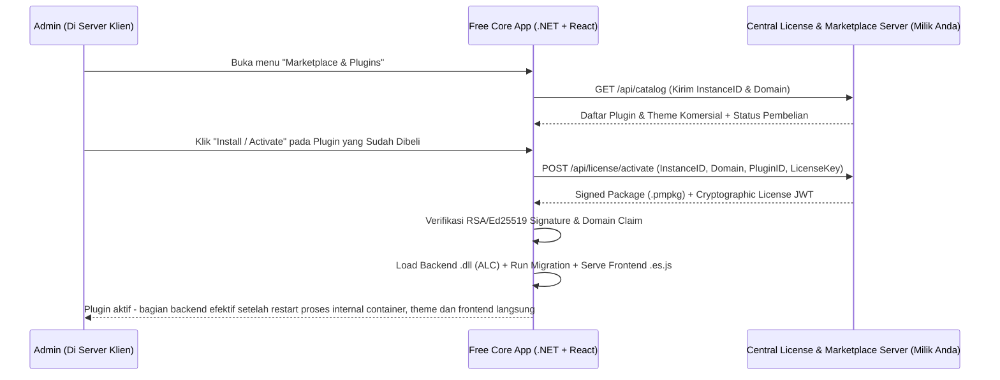
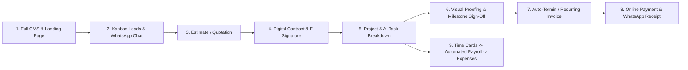

# Development Plan (DevPlan): Arsitektur Modular Plugin & Theme (.NET + Vite/React)

Dokumen ini merangkum seluruh hasil diskusi perencanaan arsitektur dan model bisnis untuk pengembangan aplikasi generasi baru pengganti sistem lama (**RISE - Ultimate Project Manager & CRM**), sebagaimana dirinci fitur-fiturnya pada [MasterPlan.md](file:///C:/TEMP/VSCODE/PM%20App/Development/MasterPlan.md).

---

> [!IMPORTANT]
> **Keputusan Arsitektur Final — SaaS Multi-Tenant (lihat [DEV_STEP.md](DEV_STEP.md) untuk rincian D1–D13 & tahapan eksekusi):**
> Platform ini dibangun dengan model **Multi-Tenant SaaS** yang di-host oleh pemilik platform menggunakan **.NET 8/9 + Vite/React + PostgreSQL (Shared Schema + `TenantId` + EF Global Filter + Row-Level Security)**.
> * **Pre-Installed Plugins & Per-Tenant Entitlement:** Seluruh plugin sudah terpasang di dalam platform. Admin tiap perusahaan (tenant) dapat mengaktifkan/menonaktifkan plugin melalui halaman *Settings > Plugins* (yang otomatis mengatur visibilitas menu di RBAC perusahaan).
> * **Alur Lisensi & Konsol Admin Platform:** Saat tenant memasukkan **Nomor Lisensi Plugin** (sekali pakai, dibuat di Konsol Admin Platform dengan durasi 1 bulan/1 tahun/Lifetime), sistem otomatis menerbitkan **Invoice berstatus Paid** dan permintaan aktivasi (**PendingApproval**) untuk disetujui oleh Super Admin di **Konsol Admin Platform**.
> * Bagian-bagian di bawah ini yang membahas katalog modul, pemetaan hook .NET, sistem `<ExtensionSlot />` React, *3-Level Theme Engine*, *Full CMS*, serta *7 Fitur Baru Modern* tetap menjadi acuan spesifikasi fitur, sedangkan mekanisme distribusi fisiknya mengikuti alur SaaS Multi-Tenant di **[DEV_STEP.md](DEV_STEP.md)**.

## 1. Keputusan Strategis & Model Bisnis

Berdasarkan hasil diskusi, berikut adalah fondasi utama dari aplikasi yang akan dibangun:

1. **Model Distribusi & Monetisasi (*Freemium / Locked Open-Core*)**:
   * **Aplikasi Inti Gratis (*Free Core App*)**: Aplikasi utama didistribusikan secara **gratis (free)** untuk menarik adopsi pengguna seluas mungkin, namun **strukturnya dikunci (*locked*)** agar kode inti tidak dapat diubah, dimodifikasi, atau dibajak dengan mudah.
   * **Komersialisasi via Plugins & Themes**: Fitur-fitur lanjutan (*add-on modules*) dan tampilan eksklusif (*themes*) dijadikan **alat komersial berbayar**. Klien hanya membeli modul atau theme yang mereka butuhkan.
2. **Pengembang Plugin & Theme (*Internal Team Only*)**:
   * Seluruh plugin dan theme resmi dikembangkan oleh **tim internal perusahaan**.
   * Hal ini menyederhanakan kompleksitas keamanan (*sandboxing* pihak ketiga) sekaligus memungkinkan penegakan standar kualitas tinggi dan proteksi tanda tangan digital (*cryptographic signing*) penuh.
3. **Stack Teknologi Utama**:
   * **Backend**: **.NET (ASP.NET Core Web API / .NET 8+)**
   * **Frontend**: **Vite + React (SPA)**
4. **Cakupan Ekstensibilitas ("Layaknya WordPress")**:
   * Sistem ekstensi tidak hanya terbatas pada penambahan logika/fitur backend, tetapi juga mencakup **Frontend penuh** (penambahan halaman baru, menu, tab, widget, hingga penggantian **Theme / Layout / Komponen UI**).
5. **Mekanisme Distribusi & Lingkungan Server Klien — Pendekatan (A)**:
   * **Runtime Upload / In-App Installation**: Plugin dan theme dapat dipasang dan diaktifkan langsung saat aplikasi berjalan (*runtime*) melalui antarmuka web tanpa perlu men-deploy atau mem-build ulang aplikasi utama.
   * **Always-Online Activation**: Lingkungan server klien terhubung ke internet sehingga aplikasi klien dapat berkomunikasi langsung dengan **Central License & Marketplace Server** milik tim Anda untuk verifikasi lisensi, pembelian, pengunduhan, dan pembaruan plugin/theme.

---

## 2. Mengapa Beralih dari PHP (Sistem Lama) ke .NET + Vite/React?

Pada sistem lama (PHP / CodeIgniter 4), penerapan model bisnis *Free Core + Commercial Plugins* memiliki celah fatal karena seluruh *source code* didistribusikan sebagai teks terbuka (`.php`). Pengguna dapat dengan mudah membuka file kode dan menghapus fungsi validasi `validate_purchase_code()`.

Kombinasi **.NET + Vite/React** menyelesaikan masalah tersebut secara tuntas:

| Aspek | Sistem Lama (PHP / CodeIgniter 4) | Sistem Baru (.NET + Vite/React) |
| :--- | :--- | :--- |
| **Proteksi Kode Inti (*Core Lock*)** | Sangat lemah (file `.php` terbuka dan mudah diedit siapa saja). | **Sangat kuat** (dikompilasi menjadi biner `.dll` / `.exe` *ReadyToRun* + *IL Obfuscation*; aset build React di-*embed* ke dalam biner .NET). |
| **Keamanan Lisensi Plugin** | Mudah di-*bypass* dengan mengedit baris kode PHP plugin. | **Terkunci secara kriptografis** (paket plugin `.dll` & `.js` ditandatangani dengan *Digital Signature* dan divalidasi secara online ke *License Server*). |
| **Tipe Data & Maintainability** | Dinamis, rawan *runtime error* saat plugin berinteraksi dengan core. | **Strictly Typed (C# & TypeScript)** melalui kontrak *Plugin SDK* yang jelas. |
| **Pengalaman UI/UX** | Server-rendered HTML + jQuery/DataTables tradisional. | **Modern SPA (Vite + React)** yang sangat responsif dengan sistem *Slot/Fill* dan *Theme Engine* dinamis. |

---

## 3. Arsitektur Paket Plugin & Theme Terpadu (*Unified Package*)

Layaknya WordPress di mana pengguna cukup memasang satu paket untuk mendapatkan fitur backend sekaligus tampilan frontend, setiap plugin atau theme dikemas dalam satu arsip terpadu (misalnya `.zip` atau ekstensi khusus `.pmpkg`):

```text
nama-plugin-atau-theme.pmpkg (ZIP Archive)
├── manifest.json          # Metadata: id, name, version, type ("plugin" | "theme"), licenseRequirements
├── signature.sig          # Tanda tangan kriptografi (RSA/Ed25519) dari tim internal
├── backend/
│   └── NamaPlugin.dll     # Compiled .NET Class Library (Controllers, Services, Hooks, EF Migrations)
└── frontend/
    ├── index.es.js        # Vite Library Mode bundle (ES Module yang dimuat dinamis oleh React)
    ├── style.css          # Stylesheet komponen atau variabel CSS Theme
    └── assets/            # Ikon, gambar, font
```

### Alur Pemasangan & Aktivasi Saat Runtime:
1. Admin memilih plugin/theme dari **In-App Marketplace** (atau mengunggah paket `.pmpkg`).
2. Backend **.NET** melakukan verifikasi **Online License** ke server lisensi pusat dan memeriksa keaslian **`signature.sig`** menggunakan *Public Key* yang tertanam di Core App.
3. Jika valid, .NET mengekstrak paket ke direktori terproteksi `/plugins/{id}`:
   * Memuat `backend/NamaPlugin.dll` ke memori menggunakan `AssemblyLoadContext`.
   * Menjalankan migrasi database plugin (`OnInstallAsync()`).
   * Mendaftarkan endpoint API dan hook backend ke pipeline ASP.NET Core.
   * Menyajikan aset `frontend/index.es.js` dan `style.css` melalui endpoint `/api/system/active-extensions`.
4. Aplikasi **React** di browser membaca daftar ekstensi aktif dari `/api/system/active-extensions` dan memuat `index.es.js` beserta `style.css` secara dinamis (*runtime dynamic `import()`*) **tanpa perlu melakukan `npm run build` ulang**.

---

## 4. Arsitektur Backend (.NET): Pemetaan Fitur Plugin Sistem Lama

Seluruh kemampuan hook pada [plugin-documentation.html](file:///C:/TEMP/VSCODE/PM%20App/Source/documentation/plugin-documentation.html) dipetakan ke dalam proyek kontrak bersama (`PMApp.Plugin.Abstractions.dll`) di .NET:

### 4.1. Dynamic Assembly Loading & Live Routing
* **`AssemblyLoadContext` (ALC)**: Memuat file `.dll` plugin **saat startup aplikasi** dari volume plugin. Unload saat runtime tidak diandalkan; penonaktifan/penghapusan diterapkan melalui restart proses (lihat §11).
* **`ApplicationPartManager` + `IActionDescriptorChangeProvider`**: Memungkinkan ASP.NET Core mengenali *Controllers* dan *Endpoints* baru dari dalam `.dll` plugin begitu plugin diaktifkan. **Untuk plugin dengan komponen backend, aktivasi efektif setelah restart proses aplikasi di dalam container yang sama (lihat §11); OS/host tidak perlu di-restart.**

### 4.2. Pemetaan Hooks Sistem Lama ke Kontrak Interface .NET

| Hook pada Sistem Lama (RISE) | Kontrak Interface di Backend .NET (`PMApp.Plugin.Abstractions`) |
| :--- | :--- |
| `register_installation_hook`<br>`register_uninstallation_hook`<br>`register_activation_hook`<br>`register_deactivation_hook`<br>`register_update_hook` | **`IPluginLifecycle`**<br>Memiliki method `OnInstallAsync()`, `OnUninstallAsync()`, `OnActivateAsync()`, `OnDeactivateAsync()`, dan `OnUpdateAsync()`. |
| `register_data_insert_hook`<br>`register_data_update_hook`<br>`register_data_delete_hook` | **EF Core `SaveChangesInterceptor` / Domain Events (`INotificationHandler<T>`)**<br>Memancarkan event setiap kali entitas utama (*Project, Task, Client, Invoice*, dll.) ditambah, diubah, atau dihapus. |
| `app_filter_payment_method_settings`<br>`app_hook_invoice_payment_extension` | **`IPaymentGatewayPlugin`**<br>Mendaftarkan metode pembayaran baru (misal: Stripe, Midtrans, Xendit, QRIS) beserta skema pengaturannya dan *webhook handler*-nya. |
| `PLUGIN_CUSTOM_STORAGE`<br>(`upload_file_to_temp`, `move_temp_file`, `get_file_content`, `delete_app_file`) | **`IFileStoragePlugin`**<br>Mengalihkan penyimpanan berkas dari lokal ke penyedia *cloud* (Google Drive, AWS S3, MinIO, Azure Blob Storage). |
| `app_filter_notification_config`<br>`app_filter_email_templates`<br>`app_filter_send_email_notification` | **`INotificationChannelPlugin` & `INotificationEventProvider`**<br>Menambahkan kategori notifikasi baru, template email/pesan baru, atau kanal pengiriman baru (WhatsApp, Telegram, Slack, Pusher). |
| `app_hook_after_cron_run` | **`IBackgroundJobPlugin`**<br>Menjalankan tugas terjadwal plugin setelah *Background Worker / Hangfire / Quartz.NET* utama selesai dieksekusi. |
| `app_hook_role_permissions_extension`<br>`app_filter_role_permissions_save_data` | **`IPermissionProviderPlugin`**<br>Mendaftarkan daftar hak akses (*permissions*) baru milik plugin ke dalam matriks *Role-Based Access Control (RBAC)* utama. |
| `app_hook_before_app_access`<br>`app_hook_after_signin`<br>`app_hook_before_signout` | **ASP.NET Core Middleware / `IAuthEventPlugin`**<br>Menjalankan logika kustom saat pengguna login, logout, atau sebelum mengakses endpoint aplikasi (misal: *SSO / 2FA / Audit Log Plugin*). |

### 4.3. Isolasi Database Plugin
* Setiap plugin yang membutuhkan tabel tambahan menggunakan **Modular EF Core `DbContext`** atau **FluentMigrator**.
* Aturan penamaan tabel wajib menggunakan prefix `plugin_{nama_plugin}_` (atau menggunakan *database schema* terpisah) dan tidak boleh mengubah struktur tabel inti secara destruktif, selaras dengan *Best Practices* sistem lama.

---

## 5. Arsitektur Frontend (Vite + React): Sistem Plugin & Theme Ala WordPress

Agar frontend **Vite + React** memiliki fleksibilitas setara WordPress tanpa mengorbankan performa SPA:

### 5.1. Vite Library Mode & Shared Dependencies
* Aplikasi utama React (*Core Host*) mengekspos instance `React`, `ReactDOM`, `ReactRouter`, state autentikasi, serta *UI Component Kit* utama melalui **Global Extension Bridge / Import Maps**.
* Setiap plugin frontend dikompilasi menggunakan **Vite Library Mode** dengan pengaturan `external: ['react', 'react-dom', 'react-router-dom']`. Hasilnya adalah file `index.es.js` berukuran sangat kecil yang langsung menyatu dengan aplikasi React utama saat dimuat.

### 5.2. Sistem `<ExtensionSlot />` (UI Hooks di React)
Aplikasi utama menyediakan komponen `<ExtensionSlot name="..." />` di seluruh titik strategis antarmuka (setara dengan filter menu, tab, dan view di RISE):

1. **Navigasi & Halaman Baru**:
   * `sidebar.staff.menu` & `sidebar.client.menu`: Menyisipkan menu baru di sidebar staf atau portal klien.
   * `routes.authenticated` & `routes.public`: Mendaftarkan halaman React baru ke *React Router*.
2. **Dashboard & Topbar**:
   * `dashboard.widgets`: Mendaftarkan widget baru ke dalam *Drag-and-Drop Dashboard Builder*.
   * `dashboard.announcement.top`: Menampilkan banner/alert di bagian paling atas dashboard.
   * `topbar.actions` & `topbar.quick_add`: Menambahkan ikon aksi di topbar atau opsi pada tombol *Quick Add*.
3. **Halaman Detail Entitas (Tab & Panel Dinamis)**:
   * `project.details.tabs` (Staf & Klien): Menambah tab baru di halaman detail proyek.
   * `client.details.tabs` & `lead.details.tabs`: Menambah tab baru di halaman profil klien/prospek.
   * `staff.profile.tabs`: Menambah tab baru di halaman detail anggota tim.
   * `task.view.right_panel`: Menyisipkan komponen di panel kanan detail tugas (misal: *Git Commit Logs* atau *Time Tracker*).
4. **Keuangan & Pengaturan**:
   * `invoice.payment.buttons`: Menampilkan komponen tombol/modal pembayaran online pada tampilan invoice.
   * `settings.admin.menu` & `settings.integration.tabs`: Menambahkan menu pengaturan plugin di halaman *Settings*.
   * `auth.signin.extension` & `auth.signup.extension`: Menyisipkan elemen tambahan pada halaman Login/Register (misal: tombol *Login with Google/SSO* atau *reCAPTCHA*).

### 5.3. Arsitektur Theme Engine 3-Level (Layaknya WordPress Theme)
Sistem **Theme** di Vite/React dibagi menjadi 3 lapisan kemampuan yang dapat dikombinasikan oleh sebuah paket Theme komersial:

* **Level 1 — Design Tokens & CSS Variables (Warna, Tipografi, Surface)**
  * Seluruh komponen inti dibangun menggunakan *semantic CSS variables* (`--pm-primary`, `--pm-bg-surface`, `--pm-sidebar-bg`, `--pm-radius-md`, `--pm-font-sans`).
  * Sebuah Theme dapat mengubah suasana visual aplikasi secara drastis (termasuk variasi *Light / Dark / High-Contrast*) hanya dengan memuat stylesheet token-nya.
* **Level 2 — Layout Shell Replacement (`AppShell` & `PortalShell`)**
  * Aplikasi utama memisahkan *Business Pages* dari *Layout Kerangka (`AppShell`)*.
  * Theme dapat mengganti kerangka aplikasi secara keseluruhan:
    * *Classic Enterprise Shell*: Sidebar kiri + Topbar (gaya klasik RISE).
    * *Modern Workspace Shell*: Sidebar ganda minimalis (ala Notion/Linear).
    * *Horizontal Executive Shell*: Navigasi atas dengan ruang kerja layar penuh.
    * *Custom Client Portal Shell*: Mengubah portal klien menjadi seperti situs *e-commerce* atau *helpcenter* modern.
* **Level 3 — Component Override Registry (*Template Override* ala WordPress)**
  * Komponen-komponen utama dirender melalui *Component Resolver*: `useThemedComponent('ProjectCard', DefaultProjectCard)`.
  * Sebuah Theme premium dapat menimpa (*override*) tampilan komponen tertentu—misalnya mengganti desain halaman `LoginPage`, `InvoicePreviewTemplate`, `DashboardStatCard`, atau `ProjectCard`—dengan komponen React kustom milik Theme tersebut tanpa mengubah logika data di baliknya.

---

## 6. Mekanisme Penguncian Core & Lisensi Online (Pendekatan A)

Karena aplikasi utama didistribusikan secara **gratis**, dikunci strukturnya, dan dijalankan di server klien yang **terhubung ke internet (Pendekatan A)**:



### Detail Pengamanan Berlapis:
1. **Binary Compilation & Asset Embedding (Penguncian Core)**:
   * Backend .NET di-*publish* dalam mode *Release* dengan *IL Obfuscation* pada modul lisensi dan loader plugin.
   * Build produksi frontend Vite/React disimpan sebagai *Embedded Resource* di dalam assembly .NET sehingga struktur antarmuka inti dan layar aktivasi lisensi tidak dapat dimodifikasi oleh pengguna.
2. **Digital Signature Verification (Anti-Modifikasi & Anti-Plugin Palsu)**:
   * *Core App* hanya akan memuat file `.dll` dan `.es.js` yang memiliki tanda tangan digital (`signature.sig`) yang cocok dengan **Public Key** resmi tim internal Anda.
3. **Domain/Instance Binding & Periodic Heartbeat (Anti-Pembajakan Lisensi)**:
   * Saat aktivasi plugin komersial, **Central License Server** menerbitkan *Signed License Token (JWT)* yang terikat pada `Domain` dan `Machine/Instance Fingerprint` server klien.
   * Secara berkala (melalui *Background Job* harian), *Core App* melakukan *heartbeat check* ke server lisensi Anda untuk memastikan lisensi tidak dipakai ganda di domain lain dan sekaligus memeriksa ketersediaan *update* versi plugin.

---

## 7. Rencana Pembagian Modul: Free Core vs. Commercial Plugins & Themes

Berdasarkan pemetaan seluruh fitur sistem lama di [MasterPlan.md](file:///C:/TEMP/VSCODE/PM%20App/Development/MasterPlan.md), berikut adalah rekomendasi pemisahan antara fitur **Gratis (Core)** dan fitur **Komersial (Plugins/Themes)**:

### A. Free Core Application *(Gratis & Terkunci — Sebagai Magnet Adopsi)*
1. **Core System & Engine**:
   * Autentikasi, Manajemen Pengguna Dasar, dan *Role-Based Access Control (RBAC)* standar.
   * *Plugin & Theme Loader Engine* beserta halaman **In-App Marketplace**.
   * Pengaturan Umum Dasar (Profil Perusahaan, Bahasa, Email SMTP, Notifikasi Web Dasar).
2. **Dashboard & Produktivitas Dasar**:
   * 1 Default Dashboard + Topbar (*Quick Add*, Notifikasi, Profil).
   * *Personal To-Do List* & *Private Notes / Sticky Note*.
3. **Project Management Dasar**:
   * Pembuatan Projects, Tasks (Daftar & Detail), Milestones, dan kalkulasi *Progress Bar* berbasis *Task Points*.
   * Unggah file lokal dasar & komentar tugas.
4. **Clients & Team Dasar**:
   * Daftar Clients & Contacts dasar.
   * Daftar Team Members dasar.

---

### B. Commercial Feature Plugins *(Berbayar — Sumber Monetisasi Utama)*

| Nama Paket Plugin Komersial | Fitur yang Diaktifkan (Berdasarkan Fitur Sistem Lama) |
| :--- | :--- |
| **1. CRM & Lead Acquisition Plugin** | • Manajemen Leads dengan tampilan **Kanban View** & tahapan (*stages*) kustom.<br>• Pembuat **Public Estimate Request Forms** untuk menjaring prospek dari luar.<br>• Impor/Ekspor data Leads & Clients via **Excel**.<br>• Pengelompokan *Client Groups* & *Custom Fields* (8 tipe input). |
| **2. Finance, Billing & Payment Gateway Plugin** | • Modul **Estimates** (Penawaran harga, *Accept/Reject*, konversi 1-klik ke Invoice/Project).<br>• Modul **Invoices & Payments** (Multi-mata uang, multi-pajak, diskon sebelum/sesudah pajak, PDF generator, kirim tagihan via email, *Invoice Reminders*).<br>• Modul **Expenses** (Pelacakan biaya per kategori/proyek/tim & laporan Laba/Rugi).<br>• Integrasi pembayaran online (**Stripe, PayPal, Paytm**, serta ekstensi lokal seperti **Midtrans/Xendit/QRIS**). |
| **3. Client Portal & Online Store Plugin** | • Akses login **Client Portal** bagi kontak pelanggan (melihat proyek, *timesheet*, estimasi, dan tagihan).<br>• Kustomisasi Dashboard khusus Portal Klien.<br>• Modul **Online Store** (katalog produk/jasa dan pemesanan langsung oleh klien).<br>• Modul **Customer Feedback** pada proyek. |
| **4. HR, Attendance & Leave Management Plugin** | • Modul **Time Cards** (Absensi *Clock In / Clock Out* dari dashboard, log kehadiran harian, & **IP Restriction**).<br>• Modul **Leave Management** (*Apply Leave, Assign Leave, Approve/Reject Workflow*, grafik ringkasan tahunan, *Custom Leave Types*).<br>• Tab **Job Info & Salary** pada profil anggota tim. |
| **5. Helpdesk, Auto-Ticket & Knowledge Base Plugin** | • Modul **Support Tickets** (Penanganan tiket klien, label, filter staf, *Instant Self-Assign*).<br>• Integrasi **IMAP Email-to-Ticket** (pembuatan dan balasan tiket otomatis dari email masuk).<br>• Modul **Knowledge Base** (artikel bantuan untuk klien) & **Internal Wiki / Help** (panduan internal staf). |
| **6. Advanced PM & Team Collaboration Plugin** | • Visualisasi **Gantt Chart** interaktif & *Clone Project*.<br>• **Project Timer** (*Start/Stop Timer*) & *Project Timesheets* yang dapat dibagikan ke klien.<br>• **Multiple Custom Dashboards** (*Drag-and-Drop Builder* & *Custom iframe Widgets*).<br>• Modul **Messaging (Live Chat)** internal & klien, **Timeline** (dinding kolaborasi tim), **Events Calendar**, dan **Announcements**. |
| **7. Third-Party Cloud & DevOps Integrations Plugin** | • **Google Drive Storage** (penyimpanan berkas di cloud).<br>• **Google Calendar 2-Way Sync**.<br>• **GitHub & Bitbucket Webhooks** (sinkronisasi log *commit* `#TaskID` ke dalam tugas).<br>• **Slack Webhook** (notifikasi kanal). *(Real-time push memakai SignalR bawaan Core, bukan Pusher.)* |
| **8. Full CMS & Public Website Builder Plugin** | • **Visual Page & Landing Page Builder** (mengubah halaman utama `/` dari layar login menjadi Website Company Profile publik).<br>• **CRM-Connected Blocks**: Blok *Portfolio Proyek* (diambil otomatis dari modul Projects), blok *Katalog Layanan/Store*, dan blok *Lead Capture Form* (langsung masuk ke Kanban Leads).<br>• **Blog, News & SEO Manager** (manajemen artikel publik, kategori, slug URL, meta tags, OpenGraph, dan `sitemap.xml` otomatis).<br>• **Dynamic Navigation & Header/Footer Builder** (dilengkapi tombol *Client Portal Login*). |
| **9. Digital Proposal, Contract & E-Signature Plugin** | • Pembuatan dokumen **Proposal, Kontrak, NDA & SPK** dinamis (otomatis menarik variabel dari *Client, Estimate*, dan *Milestones*).<br>• **Digital E-Signature**: Tanda tangan elektronik langsung di layar (*canvas signature* + verifikasi OTP) melalui *Client Portal*.<br>• **Auto-Trigger**: Saat kontrak ditandatangani → kunci PDF kontrak beserta jejak waktu/IP, otomatis buat **Project**, dan terbitkan **Invoice DP (Termin 1)**. |
| **10. Recurring Billing, Subscription & Retainer Plugin** | • **Auto-Recurring Invoices**: Penerbitan dan pengiriman tagihan berulang otomatis (bulanan/tahunan) via *.NET Background Service*.<br>• **Retainer Hours Tracker**: Pengelolaan kuota jam layanan bulanan klien yang otomatis terpotong saat staf mencatat waktu di *Project Timer* atau menyelesaikan *Support Ticket*. |
| **11. WhatsApp Business & Omnichannel Inbox Plugin** | • **Automated WhatsApp Notifications**: Pengiriman PDF Invoice, pengingat jatuh tempo tagihan, link persetujuan Estimate/Kontrak, dan notifikasi tiket langsung ke WhatsApp klien.<br>• **WhatsApp-to-Ticket & Unified CRM Chat**: Pesan masuk dari WhatsApp atau Live Chat Web otomatis menjadi *Support Ticket* atau percakapan *Leads/Clients*. |
| **12. Milestone-Based Billing & Visual Proofing Plugin** | • **Visual Annotation / Proofing**: Klien dapat memberi pin komentar revisi langsung pada titik spesifik gambar desain atau dokumen PDF.<br>• **Formal Milestone Sign-Off & Auto-Termin**: Mengaitkan *Milestone* dengan persentase nilai proyek; saat klien menekan *"Approve Milestone"*, sistem otomatis menerbitkan tagihan termin berikutnya. |
| **13. Automated Payroll, Commission & Resource Workload Plugin** | • **Automated Payroll & Payslip PDF**: Menghitung slip gaji bulanan staf otomatis berdasarkan data *Time Cards (Clock In/Out)*, jam kerja proyek (*billable hours*), lembur, potongan cuti (*Leave*), dan komisi, lalu mencatatnya ke modul **Expenses**.<br>• **Team Workload & Capacity Planner**: Visualisasi beban kerja dan ketersediaan kapasitas anggota tim sebelum penugasan proyek baru. |
| **14. AI Project & CRM Copilot Plugin (BYOK)** | • **Bring Your Own Key (BYOK)**: Klien dapat memakai API Key OpenAI / Gemini / Claude mereka sendiri.<br>• **AI Project Scoper**: Memecah deskripsi kebutuhan klien menjadi struktur *Milestones, Tasks*, dan bobot *Task Points* otomatis.<br>• **AI Proposal, CMS & Helpdesk Assistant**: Menyusun draf proposal/kontrak, artikel SEO di *Full CMS*, serta merangkum dan menyarankan balasan tiket bantuan. |
| **15. Comprehensive Audit Trail & Compliance Plugin** | • **End-to-End Activity & Data Diff Log**: Mencatat seluruh aktivitas sensitif (siapa melihat, menambah, mengubah, atau menghapus data apa) lengkap dengan perbandingan nilai **Before vs. After (JSON Diff)**, waktu, alamat IP, dan *User-Agent*.<br>• **Tamper-Proof Security Report**: Filter pencarian audit mendalam dan ekspor laporan kepatuhan untuk kebutuhan korporat/instansi. |

---

### C. Commercial UI Themes *(Berbayar — Monetisasi Tampilan Back-Office & Front-Office CMS)*
1. **Default Classic Theme** *(Gratis di dalam Core)* — Tampilan bersih standar dengan sidebar kiri.
2. **Executive Glass / Dark Pro Theme** *(Komersial - Back-Office)* — Tema premium dengan palet warna korporat modern, *glassmorphism*, dan transisi halus.
3. **Minimalist Workspace Theme** *(Komersial - Back-Office)* — Mengganti `AppShell` menjadi gaya aplikasi produktivitas modern (seperti Linear/Notion) dengan kepadatan informasi tinggi.
4. **White-Label Corporate Portal & CMS Theme Pack** *(Komersial - Front-Office & Client Portal)* — Paket tema website publik untuk **Full CMS Plugin** dan *Client Portal* (misalnya: *Software Agency Theme*, *Construction & Engineering Theme*, *Consulting Firm Theme*) sesuai identitas merek (*brand*) klien.

---

## 8. Rekomendasi Teknis & Arsitektur Spesifik (Best-Fit Stack)

Untuk mewujudkan sistem **Free Locked-Core + Commercial Plugins & Themes** dengan performa tinggi, biaya operasional rendah, dan keamanan lisensi yang kuat, berikut adalah rekomendasi teknis terbaik untuk ekosistem aplikasi ini:

### 8.1. Rekomendasi Stack Backend (.NET 8 / .NET 9)

1. **Penjadwalan Otomatis Bawaan (Mengeliminasi Masalah Cron Job di Sistem Lama)**:
   * *Masalah Sistem Lama*: Di RISE ([index.html](file:///C:/TEMP/VSCODE/PM%20App/Source/documentation/index.html#L843-L870)), pengguna wajib menyetel *Cron Job* secara manual di cPanel agar fitur IMAP, Google Calendar, dan pengingat tagihan bisa berjalan. Banyak pengguna gagal di tahap ini.
   * *Rekomendasi .NET*: Gunakan **.NET `BackgroundService` / Quartz.NET / Hangfire** yang tertanam langsung di dalam aplikasi .NET. Begitu aplikasi jalan, seluruh tugas terjadwal (termasuk jadwal milik plugin dan pengecekan lisensi harian) otomatis berjalan tanpa konfigurasi cPanel apa pun.
2. **Real-Time Engine Bawaan (Mengeliminasi Ketergantungan Pusher di Sistem Lama)**:
   * *Masalah Sistem Lama*: Di RISE ([index.html](file:///C:/TEMP/VSCODE/PM%20App/Source/documentation/index.html#L1084-L1114)), klien harus membuat akun berbayar di **Pusher** agar *Push Notification* dan *Live Chat* berfungsi.
   * *Rekomendasi .NET*: Gunakan **ASP.NET Core SignalR** secara *native*. Aplikasi Anda langsung memiliki kemampuan *Real-Time Push Notification*, *Live Chat*, dan pembaruan papan *Kanban* secara instan tanpa biaya layanan pihak ketiga.
3. **Eksekutor Migrasi Database untuk Plugin (`DbUp` atau `FluentMigrator`)**:
   * Untuk plugin yang diunggah saat *runtime* (`.pmpkg`), gunakan **FluentMigrator** atau **DbUp** yang disematkan di dalam `.dll` plugin (bukan `dotnet ef` CLI).
   * Saat `OnInstallAsync()` atau `OnUpdateAsync()` dipanggil, plugin langsung mengeksekusi migrasi skema tabelnya (`plugin_{nama}_...`) secara otomatis dan aman di dalam transaksi database.
4. **Dukungan Multi-Database (PostgreSQL & MySQL/MariaDB)**:
   * Gunakan **Entity Framework Core** dengan abstraksi provider agar klien yang terbiasa menggunakan **MySQL/MariaDB** (seperti pengguna sistem lama) maupun klien korporat yang memilih **PostgreSQL** atau **SQL Server** dapat menjalankan aplikasi tanpa kendala.

---

### 8.2. Rekomendasi Stack Frontend (Vite + React + TypeScript)

1. **UI Foundation & Themeability (`Tailwind CSS` + `CSS Variables` + `shadcn/ui`)**:
   * Gunakan arsitektur komponen berbasis **Radix UI / shadcn/ui** yang dipadukan dengan **CSS Variables** (`--primary`, `--background`, `--card`, `--sidebar`, `--radius`).
   * *Alasan*: Sangat memudahkan tim internal Anda ketika membuat **Commercial Themes**. Satu theme baru dapat dibuat hanya dengan memodifikasi palet variabel CSS dan mengganti komponen `AppShell` tanpa perlu menulis ulang logika form atau tombol.
2. **Tabel & Drag-and-Drop Modern**:
   * **`TanStack Table` (React Table)**: Menggantikan jQuery DataTables pada sistem lama. Sangat fleksibel bagi plugin untuk menyuntikkan kolom tambahan (seperti *Custom Fields*) atau tombol aksi baru pada baris tabel.
   * **`@dnd-kit/core`**: Digunakan untuk membangun **Drag-and-Drop Custom Dashboard Builder**, **Kanban Leads**, dan **Kanban Tasks** yang jauh lebih mulus dibandingkan jQuery UI lama.
3. **State Management & Data Fetching (`TanStack Query` + `Zustand`)**:
   * Ekspor instance `QueryClient` (TanStack Query) dan store global `Zustand` pada **`@pmapp/plugin-sdk`**.
   * Saat plugin komersial dimuat, plugin dapat langsung memanggil cache data pengguna yang sedang login, memicu *toast notification*, atau me-refresh data tabel utama dengan satu baris kode.

---

### 8.3. Rekomendasi Desain "Central License & Marketplace Server" (Mesin Monetisasi)

Karena menggunakan **Pendekatan (A) — Always-Online Activation**, Anda sangat disarankan membangun satu layanan pusat ringan (**License & Marketplace Server**, juga menggunakan .NET) yang menjadi pusat pendapatan Anda:

1. **In-App Marketplace dengan Fitur "1-Click Free Trial (7/14 Hari)"**:
   * Di dalam aplikasi gratis klien, tampilkan menu **"Marketplace / Add-ons"** yang menarik katalog plugin dan theme langsung dari server Anda.
   * Berikan tombol **"Coba Gratis 14 Hari"** untuk plugin komersial (misal: *Plugin Finance & Invoicing* atau *Plugin HR & Attendance*).
   * Saat diklik, server Anda mengirimkan paket `.pmpkg` beserta *Trial License JWT* yang berlaku 14 hari.
   * **Efek Psikologis & Konversi Penjualan**: Setelah klien memakai fitur *Invoicing* atau *Absensi* selama 14 hari dan data mereka sudah tersimpan di dalamnya, ketika masa *trial* habis, plugin otomatis terkunci (*soft-lock*: data tidak hilang, tetapi menu/API plugin dinonaktifkan hingga klien membeli lisensi penuh). Ini akan meningkatkan konversi pembelian plugin secara signifikan.
2. **Strategi Paket Penjualan (*Pricing & Bundling*)**:
   * **Satuan (*A La Carte*)**: Klien membeli per plugin (misal hanya butuh *Plugin HR* saja).
   * **Paket Bundling (*Starter / Business / Enterprise Pack*)**: Menjual paket beberapa plugin + theme premium dengan harga lebih hemat.
   * **Lisensi Update & Support Tahunan**: Pembelian mencakup pembaruan versi otomatis (*1-Click Auto Update* langsung dari dalam aplikasi) selama 1 tahun.
3. **Mekanisme Keamanan *Soft-Heartbeat* (Toleransi Gangguan Internet Sementara)**:
   * Aplikasi klien melakukan pengecekan lisensi (*heartbeat*) ke server Anda setiap 24 jam sekali di latar belakang.
   * Gunakan **Grace Period (Masa Tenggang) 3–7 Hari** di dalam *Signed JWT License*. Artinya, jika internet di server klien atau server lisensi Anda sedang *down* sementara selama beberapa jam, plugin komersial klien **tidak langsung mati**, melainkan tetap berjalan menggunakan token JWT lokal hingga koneksi kembali normal.

---

### 8.4. Rekomendasi Kontrak SDK Internal (`Plugin SDK`)

Agar tim internal Anda dapat memproduksi plugin dan theme dengan cepat, buatlah 2 paket SDK internal:

1. **`PMApp.Plugin.Abstractions` (NuGet Package Internal untuk C# .NET)**:
   ```csharp
   public interface IPlugin
   {
       PluginManifest Manifest { get; }
       void ConfigureServices(IServiceCollection services, IConfiguration config);
       void ConfigureEndpoints(IEndpointRouteBuilder endpoints);
       Task OnInstallAsync(IServiceProvider services, CancellationToken ct);
       Task OnUpdateAsync(string previousVersion, IServiceProvider services, CancellationToken ct);
       Task OnUninstallAsync(IServiceProvider services, CancellationToken ct);
   }
   ```
2. **`@pmapp/plugin-sdk` (NPM Package Internal untuk Vite/React TypeScript)**:
   ```typescript
   export interface FrontendPluginContext {
     registerRoute: (route: PluginRoute) => void;
     registerMenuItem: (target: 'staff' | 'client', item: MenuItem) => void;
     registerSlotComponent: (slotName: ExtensionSlotName, component: React.ComponentType<any>) => void;
     registerDashboardWidget: (widget: DashboardWidgetDefinition) => void;
     registerTheme: (theme: ThemeDefinition) => void;
     overrideComponent: (componentKey: OverridableComponentKey, component: React.ComponentType<any>) => void;
   }
   ```

---

### 8.5. Rekomendasi Tahapan Pengembangan (Phased Roadmap)

Agar proyek berjalan terukur dan tidak membengkak di awal, urutan pembangunan yang paling direkomendasikan adalah:

* **Tahap 1 — Core Foundation & Extension Engine**:
  * Membangun *Core Host* (.NET Web API + Vite/React), sistem autentikasi & RBAC dasar, *Dynamic Plugin/Theme Loader* (`.pmpkg`), sistem `<ExtensionSlot />` di React, serta *3-Level Theme Engine*.
* **Tahap 2 — Free Core Modules (MVP Gratis)**:
  * Membangun modul gratis: Dashboard dasar, Projects, Tasks, Milestones, Clients & Contacts dasar, Team Members dasar, Personal To-Do & Notes.
* **Tahap 3 — Central License & Marketplace Server**:
  * Membangun server lisensi pusat, *Cryptographic Package Signer CLI* (alat internal untuk membungkus dan menandatangani `.dll` + `.es.js` menjadi `.pmpkg`), serta halaman *In-App Marketplace* di aplikasi utama.
* **Tahap 4 — Batch Pertama Commercial Plugins & Themes (Prioritas Monetisasi Tertinggi)**:
  1. *Finance & Invoicing Plugin* (Estimates, Invoices, Payments, Expenses).
  2. *CRM & Leads Kanban Plugin* (Leads, Public Estimate Forms).
  3. *HR, Time Cards & Leave Plugin* (Absensi Clock-In/Out + IP Restriction & Cuti).
  4. *Helpdesk & IMAP Auto-Ticket Plugin*.
  5. *1–2 Commercial Themes* (misal: *Executive Dark/Glass Theme* & *White-Label Client Portal Theme*).


---

## 9. Arsitektur Khusus: "Full CMS & Public Website Builder Plugin"

Keputusan untuk menghadirkan **Full CMS & Public Website Builder** sebagai **Commercial Plugin** memberikan keunggulan kompetitif yang sangat besar dibanding sistem lama (RISE). Klien tidak perlu lagi mengelola WordPress terpisah untuk *Company Profile* mereka karena website depan (*Front-Office*) dan sistem manajemen proyek/CRM (*Back-Office*) menyatu dalam satu platform.

### 9.1. Cara Kerja & Pengalaman Pengguna
* **Kondisi Default (Tanpa Plugin CMS)**:
  * Saat pengunjung mengakses `https://domainklien.com/`, aplikasi langsung menampilkan halaman **Sign In / Client Portal Login** (sama seperti sistem lama).
* **Kondisi Setelah "Full CMS & Public Website Builder Plugin" Diaktifkan**:
  * Plugin mengambil alih rute utama (`/`) dan merender **Public Website / Landing Page Perusahaan**.
  * Tersedia tombol **"Client Portal / Login"** di navigasi atas website untuk masuk ke area kerja atau portal pelanggan.

### 9.2. Fitur Unggulan: "CRM-Connected CMS Blocks"
Berbeda dengan CMS biasa yang statis, plugin CMS ini terhubung langsung dengan data operasional di dalam aplikasi PM & CRM:
1. **Live Project Portfolio Block**:
   * Pada modul *Projects*, admin cukup mencentang opsi *"Tampilkan di Portofolio Publik"*. Blok portofolio di halaman depan website otomatis menampilkan studi kasus proyek tersebut tanpa perlu input ulang.
2. **Live Service & Online Store Block**:
   * Menampilkan daftar layanan/paket harga dari modul *Online Store* langsung di halaman *Landing Page* publik, lengkap dengan tombol pemesanan (*Checkout / Order*).
3. **Integrated Lead Capture & Estimate Request Block**:
   * Formulir kontak atau *Request a Quote* yang dipasang di halaman CMS langsung terhubung ke modul *Estimate Requests* dan otomatis membuat kartu prospek baru di papan **Kanban Leads** beserta notifikasi *real-time* (via SignalR) ke tim sales.
4. **Visual Page Builder & Blog Engine**:
   * Menggunakan *Visual Block/Section Editor* di React (seperti **Puck** atau **Craft.js** untuk tata letak halaman, dipadukan dengan **TipTap / BlockNote** untuk penulisan artikel blog & berita).

### 9.3. Fondasi Ringan yang Wajib Disiapkan di Core App (Tahap 1)
Agar *Core App* (.NET + Vite/React) siap dipasangi **Full CMS Plugin** kapan saja tanpa perlu membongkar kode inti:

1. **Dynamic Root Route Takeover (`registerRootRoute`)**:
   * Di `@pmapp/plugin-sdk`, sediakan fungsi `registerPublicRootHandler()`. Jika tidak ada plugin yang mendaftar, `/` menampilkan halaman Login. Jika *Full CMS Plugin* aktif, `/` menampilkan *Home Page* dari CMS.
2. **Server-Side SEO & OpenGraph Meta Injector di Backend .NET**:
   * Karena frontend berbasis SPA (Vite + React), *crawler* mesin pencari (Googlebot) dan *link preview* (WhatsApp/LinkedIn/X) membutuhkan metadata HTML dari sisi server.
   * Backend **.NET** menyediakan interface `IPublicSeoMetadataProvider`. Saat *Full CMS Plugin* aktif, middleware .NET menyuntikkan `<title>`, `<meta name="description">`, `<meta property="og:image">`, JSON-LD schema, serta menghasilkan `/sitemap.xml` dan `/robots.txt` secara dinamis.
3. **Pemisahan `Private Storage` vs. `Public Media Library`**:
   * Di *Core App*, pisahkan endpoint penyimpanan berkas menjadi:
     * **Private Files** (`/api/files/private/*` — butuh autentikasi, untuk dokumen proyek, kontrak, dan lampiran tiket).
     * **Public Media** (`/media/public/*` — dapat diakses publik dan di-*cache* cepat, untuk gambar banner CMS, logo, thumbnail artikel blog, dan foto portofolio).


---

## 10. Spesifikasi Fitur Baru Modern (Melampaui Sistem Lama RISE)

Untuk menjadikan aplikasi baru ini jauh lebih unggul dibandingkan sistem lama (RISE), berikut adalah spesifikasi arsitektur untuk **7 kapabilitas baru** yang telah dipilih:

### 10.1. Alur Bisnis End-to-End yang Terhubung Penuh
Dengan masuknya fitur-fitur baru ini, platform Anda memiliki siklus operasional bisnis (*end-to-end lifecycle*) tanpa putus:



### 10.2. Detail Teknis Masing-Masing Modul Baru di .NET + Vite/React

1. **Digital Proposal, Contract & E-Signature**:
   * **Backend (.NET)**: Menggunakan *Template Engine* untuk menggabungkan variabel (`{{Client.CompanyName}}`, `{{Estimate.Total}}`, `{{Project.Milestones}}`) dan menghasilkan PDF yang dikunci dengan hash **SHA-256** setelah ditandatangani.
   * **Frontend (React)**: Menyediakan *Signature Pad Canvas* di *Client Portal* beserta pencatatan alamat IP, *timestamp*, dan verifikasi OTP.
2. **Recurring Billing, Subscription & Retainer Management**:
   * **Backend (.NET)**: Menggunakan `BackgroundService` / Quartz.NET untuk mengevaluasi jadwal tagihan berulang (`Monthly`, `Quarterly`, `Yearly`) setiap hari, menerbitkan invoice otomatis, serta memotong kuota jam *Retainer* saat entri `ProjectTimesheet` atau `TicketTimeLog` disimpan.
3. **WhatsApp Business & Omnichannel Inbox**:
   * **Backend (.NET)**: Mengimplementasikan `INotificationChannelPlugin` dan Webhook Receiver untuk **WhatsApp Cloud API (Meta)** atau gateway WhatsApp lokal (Fonnte / Wablas / WAHA).
   * **Frontend (React)**: Menyediakan *Unified Chat Inbox* berbasis **SignalR** sehingga staf dapat membalas chat WhatsApp klien langsung dari halaman tiket atau CRM.
4. **Milestone-Based Billing & Visual Proofing**:
   * **Frontend (React)**: Komponen *Image/PDF Pinning Canvas* di mana klien dapat mengklik koordinat `(x, y)` pada gambar desain atau halaman PDF untuk meninggalkan komentar revisi.
   * **Backend (.NET)**: Menambahkan atribut `BillingPercentage` pada entitas `Milestone`. Saat status milestone berubah menjadi `ClientApproved`, sistem otomatis men-trigger pembuatan draf/pengiriman Invoice sejumlah persentase termin tersebut.
5. **Automated Payroll, Commission & Resource Workload**:
   * **Backend (.NET)**: Mengagregasi data dari `TimeCards` (jam kerja hadir), `Leaves` (cuti berbayar vs. tidak berbayar), `ProjectTimesheets` (*billable hours*), dan `JobInfo.Salary` untuk menghitung komponen gaji pokok, tunjangan, lembur, komisi, dan potongan setiap akhir periode.
   * **Frontend (React)**: Menampilkan kalender matriks **Resource Capacity Heatmap** (hijau = kapasitas luang, kuning = optimal, merah = *overloaded*) serta generator slip gaji PDF (*Payslip*).
6. **AI Project & CRM Copilot (BYOK - Bring Your Own Key)**:
   * **Backend (.NET)**: Menggunakan abstraksi **`Microsoft.Extensions.AI`** sehingga klien dapat memilih provider AI mereka sendiri (OpenAI, Google Gemini, Anthropic Claude, atau Ollama lokal) dengan memasukkan API Key di menu *Settings > AI Copilot*.
   * **Frontend (React)**: Menyediakan tombol *"Generate with AI"* pada modal pembuatan Project (otomatis membuat daftar Milestone & Task beserta poinnya), editor Proposal/CMS, dan ringkasan diskusi panjang pada Support Ticket.
7. **Comprehensive Audit Trail (Rekam Jejak Audit Sistem)**:
   * **Fondasi di Core (.NET EF Core `SaveChangesInterceptor`)**:
     * Di dalam *Core App*, setiap entitas mewarisi interface `IAuditableEntity`.
     * Saat `DbContext.SaveChangesAsync()` dipanggil (baik oleh Core maupun oleh Plugin), *Interceptor* secara otomatis menangkap `UserId`, `IpAddress`, `UserAgent`, `ActionType` (`Create`, `Update`, `Delete`, `Login`, `Export`), `EntityName`, `RecordId`, serta serialisasi JSON **`OldValues` vs. `NewValues`**.
   * **Tampilan di Frontend (React)**:
     * Menyediakan halaman **Audit Log Viewer** dengan tampilan *side-by-side diff* (menyorot field mana yang berubah dari nilai lama ke nilai baru) yang tidak dapat dihapus atau diedit oleh pengguna biasa (*immutable audit log*).


---

## 11. Keputusan D5: Aktivasi Plugin via Restart Proses di Dalam Container (Tanpa Restart OS/Host)

**Keputusan:** Plugin baru **boleh** memerlukan restart, selama restart itu terjadi **di dalam Docker yang sama** dan tidak menyentuh komputer/OS inang. Tidak perlu hot-load/unload di runtime, dan **image Docker tidak perlu di-build ulang**.

### 11.1. Mengapa pendekatan ini dipilih
* **Lebih andal:** memuat/membongkar `.dll` saat runtime di ASP.NET Core rumit (route dinamis, referensi tertahan, file terkunci di Windows). Memuat plugin saat startup jauh lebih sederhana dan dapat diuji.
* **Migrasi lebih aman:** migrasi database plugin berjalan saat startup, **sebelum** aplikasi menerima trafik.
* **Penghapusan bersih:** file plugin dihapus saat startup sebelum dimuat, sehingga tidak ada masalah file terkunci.
* **Tidak perlu rebuild image:** plugin berada di *volume*, bukan di dalam image.

### 11.2. Tata letak container
```text
Container (satu image Core)
├── Launcher/Supervisor (PID 1)  -> menjalankan Core.Api sebagai proses anak; me-restart bila diminta
├── Core.Api (.NET)              -> memuat plugin dari /data/plugins saat startup
└── Volume (persisten, di luar image)
    ├── /data/plugins/{id}/{version}/   # paket terekstrak (backend/ + frontend/)
    ├── /data/plugins/_staging/         # paket baru menunggu diterapkan
    ├── /data/files/                    # berkas pengguna
    └── (database di container/host terpisah)
```

### 11.3. Alur instal / aktif / nonaktif / hapus
1. Admin mengunggah atau memilih plugin (paket diverifikasi: signature, manifest, kompatibilitas SemVer, dependensi, lisensi).
2. Core mengekstrak ke `_staging`, mencatat status `Pending` di `PluginRegistry`. UI menampilkan **"Perlu restart aplikasi untuk menerapkan"**.
3. Admin menekan **"Terapkan & Restart"** (atau jadwalkan). Core menyelesaikan permintaan berjalan, lalu **keluar dengan kode khusus** (mis. `exit 75`).
4. Launcher di dalam container membaca kode keluar dan **menjalankan ulang Core.Api** (hitungan detik; container tetap hidup).
5. Saat startup: (a) hapus plugin berstatus `PendingRemoval`, (b) pindahkan `Pending` dari staging ke folder versi, (c) jalankan migrasi plugin dalam transaksi, (d) muat `.dll`, daftarkan service/endpoint, (e) tandai `Active`, baru (f) terima trafik.
6. Jika langkah (c)/(d) gagal: plugin ditandai `Failed`, perubahan dibatalkan, **Core tetap berjalan tanpa plugin tersebut**, galat tampil di halaman admin.

**Cadangan jika launcher internal tidak diinginkan:** Core keluar, lalu `restart: unless-stopped` pada Docker yang me-restart *container* (bukan host). Perilaku akhirnya sama.

### 11.4. Apa yang tidak perlu restart
| Jenis perubahan | Perlu restart proses? |
| :--- | :--- |
| Theme / plugin hanya frontend (JS/CSS) | **Tidak** (dimuat dinamis oleh React, tanpa `npm run build`) |
| Pengaturan plugin & data | Tidak |
| Plugin dengan komponen backend (`.dll`, endpoint, migrasi) | **Ya**, restart proses di dalam container |
| Update versi Core (image baru) | Ya, ganti container (`docker compose pull && up -d`); plugin & data aman di volume |

### 11.5. Catatan penting
* **Downtime singkat** (beberapa detik) saat restart. UI sebaiknya menampilkan layar "sedang menerapkan" dan menyambung kembali otomatis (klien SignalR *reconnect*).
* **Satu kali restart bisa menerapkan beberapa plugin sekaligus** (batch), jadi admin tidak perlu restart per plugin.
* **Bila Core berjalan lebih dari satu instance** (skala horizontal), setiap instance harus dimulai ulang dan migrasi hanya boleh dijalankan oleh satu instance. Untuk MVP (single-tenant, satu container) ini belum relevan.
* **Akses ke Docker socket tidak diperlukan** pada rancangan ini; Core hanya me-restart prosesnya sendiri. Jangan memberi container akses ke Docker socket demi kemudahan, karena itu membuka risiko keamanan besar.
* Pendekatan ini **belum divalidasi**; validasi lewat spike R1 di DEV_STEP.md (Fase 0).
