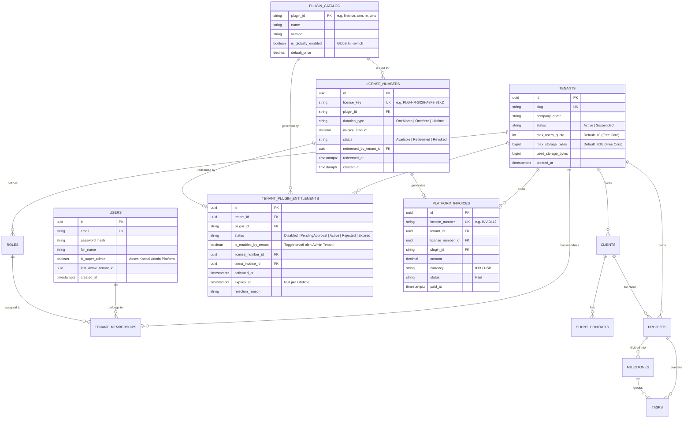

# Technical & UI Specification (TechSpec) — PM App SaaS Multi-Tenant

Dokumen ini adalah spesifikasi teknis dan antarmuka (*Engineering & UI Blueprint*) untuk implementasi aplikasi **PM App** berdasarkan keputusan final **D1–D13** pada [DEV_STEP.md](DEV_STEP.md), arsitektur pada [DevPlan.md](DevPlan.md), fitur referensi pada [MasterPlan.md](MasterPlan.md), dan acuan visual pada folder [prototype/](prototype/README.md).

---

## 1. Struktur Monorepo & Arsitektur Proyek (Keputusan D6)

Repositori utama (**Core + SDK Monorepo**) memiliki tata letak direktori baku sebagai berikut:

```text
pm-app-core/
├── src/
│   ├── Core.Api/                       # ASP.NET Core 8/9 Web API (Host Utama)
│   │   ├── Common/                     # Middleware, Filters, ProblemDetails, SignalR Hubs
│   │   ├── Infrastructure/
│   │   │   ├── Persistence/            # AppDbContext, RLS ConnectionInterceptor, Migrations
│   │   │   ├── Auditing/               # AuditSaveChangesInterceptor
│   │   │   ├── Plugins/                # PluginStartupLoader, EntitlementEndpointFilter
│   │   │   └── Storage/                # TenantFileStorageService (/data/files/{tenant_id})
│   │   ├── Modules/                    # Vertical Slices untuk Modul Free Core
│   │   │   ├── Auth/                   # SignUp, Login, Refresh, SwitchTenant
│   │   │   ├── Tenants/                # Profil perusahaan, Kuota user/storage
│   │   │   ├── Rbac/                   # Roles, Permissions (Core + Active Plugins)
│   │   │   ├── Clients/                # Clients & ClientContacts
│   │   │   ├── Projects/               # Projects, ProjectMembers, Milestones, Tasks
│   │   │   ├── Workspace/              # Notes, TodoItems, Dashboard, Notifications
│   │   │   └── PlatformAdmin/          # Konsol Super Admin (Tenants, Licenses, Approvals, Invoices)
│   │   └── Program.cs
│   │
│   ├── Plugin.Abstractions/            # Paket NuGet Internal (PMApp.Plugin.Abstractions)
│   │   ├── IPlugin.cs                  # Kontrak siklus hidup & registrasi service/endpoint
│   │   ├── ITenantContext.cs           # Akses TenantId & UserId aktif
│   │   ├── IPluginDbMigration.cs       # Kontrak migrasi tabel plugin
│   │   └── Attributes/                 # [RequirePlugin("plugin-id")]
│   │
│   ├── Core.Web/                       # Frontend Utama (Vite + React + TypeScript)
│   │   ├── src/
│   │   │   ├── app/                    # Router, Providers (TanStack Query, Auth, SignalR)
│   │   │   ├── layouts/
│   │   │   │   ├── TenantAppShell.tsx  # Layout utama Tenant (Sidebar Navy + Topbar + AI Assistant)
│   │   │   │   └── PlatformShell.tsx   # Layout khusus Super Admin (Dark Charcoal + Teal)
│   │   │   ├── extensions/             # ExtensionRegistry, <ExtensionSlot />, DynamicPluginLoader
│   │   │   ├── theme/                  # Design Tokens (CSS Variables) & ThemeProvider
│   │   │   ├── components/ui/          # Komponen dasar berbasis shadcn/ui (Radix + Tailwind)
│   │   │   └── features/               # Halaman & komponen per modul (dashboard, projects, plugins, admin)
│   │   └── vite.config.ts
│   │
│   └── PluginSdk.Web/                  # Paket NPM Internal (@pmapp/plugin-sdk)
│       ├── index.ts                    # Kontrak FrontendPluginContext, SlotProps, Hooks bersama
│       └── package.json
│
├── samples/
│   └── ReferencePlugin/                # Plugin referensi untuk uji end-to-end Fase 5
└── tests/
    ├── Core.UnitTests/
    ├── Core.IntegrationTests/
    └── TenantIsolationTests/           # Uji otomatis anti-kebocoran data lintas tenant
```

* **Repositori Plugin Komersial Terpisah** (misal `pm-plugin-finance`, `pm-plugin-crm`, `pm-plugin-hr`):
  * Mengonsumsi paket privat `PMApp.Plugin.Abstractions` (NuGet) dan `@pmapp/plugin-sdk` (npm).
  * Pipeline CI/CD platform menggabungkan hasil build (`*.dll` dan `dist/index.es.js`) dari setiap repositori plugin ke dalam direktori `/app/plugins/{plugin-id}/` pada image Docker rilis platform.

---

## 2. Skema Database (ERD) & Isolasi Multi-Tenant PostgreSQL (Keputusan D3)

### 2.1. Entity-Relationship Diagram (ERD Inti & Lisensi Platform)



### 2.2. Aturan Tabel Bisnis & Kalkulasi Progres (Warisan Sistem Lama RISE)
* **`projects`**: `id`, `tenant_id`, `client_id`, `title`, `description`, `start_date`, `deadline`, `status` (`Open`, `InProgress`, `Completed`, `OnHold`, `Canceled`), `labels[]`, `is_deleted`, `deleted_at`.
* **`milestones`**: `id`, `tenant_id`, `project_id`, `title`, `due_date`, `sort_order`.
* **`tasks`**: `id`, `tenant_id`, `project_id`, `milestone_id`, `title`, `description`, `points` (*integer, default 1 — digunakan untuk kalkulasi progress bar proyek & milestone*), `status` (`ToDo`, `InProgress`, `Review`, `Done`), `priority` (`Low`, `Medium`, `High`, `Urgent`), `assigned_to_user_id`, `deadline`, `sort_order`.
* **`audit_logs`**: `id`, `tenant_id` (nullable untuk aksi Super Admin), `actor_user_id`, `action` (`Create`, `Update`, `Delete`, `Login`, `LicenseRedeem`, `LicenseApprove`), `entity_name`, `entity_id`, `old_values_json`, `new_values_json`, `ip_address`, `user_agent`, `created_at` (*immutable: tidak memiliki endpoint update/delete*).

### 2.3. Mekanisme Isolasi Ganda: EF Core Global Filter + PostgreSQL RLS

1. **Lapis Pertama — EF Core Global Query Filter (Di Aplikasi .NET)**:
   Setiap entitas milik tenant wajib mengimplementasikan `ITenantEntity`:
   ```csharp
   public interface ITenantEntity
   {
       Guid TenantId { get; set; }
   }
   ```
   Di `AppDbContext.OnModelCreating`, filter dipasang otomatis ke semua entitas `ITenantEntity` (termasuk tabel milik plugin):
   ```csharp
   modelBuilder.Entity<TEntity>()
       .HasQueryFilter(e => e.TenantId == _tenantContext.CurrentTenantId && !e.IsDeleted);
   ```

2. **Lapis Kedua — PostgreSQL Row-Level Security (Di Level Database)**:
   Saat koneksi PostgreSQL dibuka oleh EF Core (`DbConnectionInterceptor`), aplikasi mengeksekusi:
   ```sql
   SELECT set_config('app.current_tenant_id', @tenantId::text, true);
   ```
   Dan setiap tabel bisnis (baik tabel Core maupun tabel `plugin_{id}_*`) wajib memiliki policy RLS:
   ```sql
   ALTER TABLE projects ENABLE ROW LEVEL SECURITY;
   ALTER TABLE projects FORCE ROW LEVEL SECURITY;

   CREATE POLICY tenant_isolation_policy ON projects
       USING (tenant_id = NULLIF(current_setting('app.current_tenant_id', true), '')::uuid)
       WITH CHECK (tenant_id = NULLIF(current_setting('app.current_tenant_id', true), '')::uuid);
   ```
   *Manfaat*: Sekalipun ada developer plugin yang menulis *raw SQL query* dan lupa menambahkan `WHERE tenant_id = ...`, PostgreSQL secara otomatis memblokir akses ke baris milik perusahaan lain.

---

## 3. Kontrak Autentikasi, JWT, REST API & SignalR

### 3.1. Struktur Payload JWT & Resolusi Tenant (Keputusan D13)
Karena menggunakan **satu domain aplikasi utama** (`app.domain.com`), identitas tenant aktif dibawa di dalam **Signed JWT Access Token** (masa berlaku 15 menit, didampingi HttpOnly Refresh Token):

```json
{
  "sub": "9b1deb4d-3b7d-4bad-9bdd-2b0d7b3dcb6d",
  "email": "rina@acmestudio.com",
  "name": "Rina",
  "tenant_id": "1b9d6bcd-bbfd-4b2d-9b5d-ab8dfbbd4bed",
  "tenant_slug": "acme-studio",
  "role": "TenantAdmin",
  "is_super_admin": false,
  "active_plugins": ["finance", "crm"],
  "exp": 1795521000
}
```
* **Alur Pindah Perusahaan (*Workspace Switcher*)**: Jika seorang user menjadi anggota di lebih dari satu perusahaan, klik dropdown perusahaan di kiri atas sidebar akan memanggil `POST /api/v1/auth/switch-tenant` dengan `{ "targetTenantId": "..." }` dan menerbitkan JWT baru untuk tenant tersebut.

### 3.2. Daftar Endpoint REST API Utama (`/api/v1`)

| Kelompok | Method & Path | Fungsi Utama |
| :--- | :--- | :--- |
| **Auth & Onboarding** | `POST /api/v1/auth/register-tenant` | Self-service sign up perusahaan baru + akun Admin pertama (D10) |
| | `POST /api/v1/auth/login` | Login & terbitkan JWT untuk `last_active_tenant_id` |
| | `POST /api/v1/auth/switch-tenant` | Pindah workspace perusahaan aktif |
| **Core PM & CRM** | `GET/POST /api/v1/clients` | Daftar & tambah klien (+ dukungan *10s soft-delete undo*) |
| | `GET/POST /api/v1/projects` | Daftar proyek, filter status/deadline/label, kalkulasi progres |
| | `GET/POST /api/v1/projects/{id}/tasks` | Daftar & tambah tugas (mendukung *batch add* & *batch update*) |
| | `PATCH /api/v1/tasks/{id}/status` | Geser kartu Kanban tugas / centang selesai instan |
| | `GET/POST /api/v1/projects/{id}/milestones` | Kelola milestone & progres berbasis *Task Points* |
| **Plugin & Lisensi (Sisi Tenant)** | `GET /api/v1/tenant/plugins` | Daftar semua plugin terpasang + status entitlement tenant saat ini |
| | `POST /api/v1/tenant/plugins/redeem` | Input nomor lisensi → buat `Invoice Paid` + status `PendingApproval` (D9) |
| | `PATCH /api/v1/tenant/plugins/{pluginId}/toggle` | Aktifkan/nonaktifkan plugin yang sudah `Active` (mengatur visibilitas menu RBAC) (D8) |
| **Konsol Admin Platform (Super Admin)** | `GET/POST /api/v1/platform/tenants` | Kelola seluruh perusahaan terdaftar & batas kuota |
| | `POST /api/v1/platform/licenses/generate` | Buat nomor lisensi baru (`pluginId`, `durationType`, `invoiceAmount`) (D11) |
| | `GET /api/v1/platform/license-requests` | Antrean permintaan aktivasi lisensi (`Pending`, `Approved`, `Rejected`) |
| | `POST /api/v1/platform/license-requests/{id}/approve` | Setujui permintaan → ubah entitlement jadi `Active` & hitung `expires_at` |
| | `POST /api/v1/platform/license-requests/{id}/reject` | Tolak permintaan dengan alasan penolakan (`rejection_reason`) |
| | `GET /api/v1/platform/invoices` | Daftar seluruh invoice lisensi platform |

---

## 4. Spesifikasi Kontrak `Plugin SDK` & Gerbang Entitlement

### 4.1. Gerbang Keamanan API Plugin di Backend (.NET)
Setiap plugin mendaftarkan endpoint-nya di bawah grup `/api/v1/p/{pluginId}/*`. Core secara otomatis memasang **`PluginEntitlementEndpointFilter`**:

```csharp
public sealed class PluginEntitlementEndpointFilter(string pluginId) : IEndpointFilter
{
    public async ValueTask<object?> InvokeAsync(EndpointFilterInvocationContext ctx, EndpointFilterDelegate next)
    {
        var tenantCtx = ctx.HttpContext.RequestServices.GetRequiredService<ITenantContext>();
        var checker = ctx.HttpContext.RequestServices.GetRequiredService<IPluginEntitlementChecker>();

        // Wajib berstatus Active, tidak Expired, dan toggle tenant = ON
        if (!await checker.IsPluginEnabledForTenantAsync(tenantCtx.CurrentTenantId, pluginId))
        {
            return Results.Problem(
                title: "Plugin Not Active",
                detail: $"Plugin '{pluginId}' belum aktif atau lisensi telah kedaluwarsa untuk perusahaan Anda.",
                statusCode: StatusCodes.Status403Forbidden);
        }

        return await next(ctx);
    }
}
```
*Penting*: Dengan filter otomatis ini, menyembunyikan menu di frontend selalu dibarengi dengan pemblokiran akses API di backend.

### 4.2. Katalog Resmi `<ExtensionSlot />` di Frontend (React)

Aplikasi utama menyediakan komponen `<ExtensionSlot name="..." context={...} />`. Komponen dari suatu plugin **hanya dirender oleh `<ExtensionSlot />` apabila**:
1. `pluginId` termasuk di dalam daftar `active_plugins` milik tenant saat ini, **DAN**
2. Pengguna yang sedang login memiliki izin RBAC (`permission`) yang disyaratkan oleh komponen slot tersebut.

| Nama Slot (`ExtensionSlotName`) | Lokasi di UI | Data `context` (Props) yang Dikirim ke Plugin | Contoh Penggunaan oleh Plugin |
| :--- | :--- | :--- | :--- |
| `sidebar.addons` | Sidebar kiri di bawah seksi **ADD-ONS** (lihat prototype `01`, `02`, `04`) | `{ tenantId, userPermissions }` | Menampilkan menu **Finance**, **CRM & Leads**, **HR & Attendance** |
| `dashboard.widgets` | Area widget pada halaman Dashboard | `{ tenantId, dateRange }` | Kartu ringkasan *Unpaid Invoices* atau *Today's Attendance* |
| `topbar.quick_add` | Dropdown tombol **`+ Quick Add`** di topbar | `{ tenantId, openModal }` | Menambah pintasan *"Create Invoice"* atau *"Add Lead"* |
| `project.details.tabs` | Baris tab pada halaman Detail Proyek (lihat prototype `04`) | `{ projectId, clientId, projectStatus, canEdit }` | Menambah tab **🧩 Invoices**, **🧩 Estimates**, **🧩 Leads**, atau **🧩 Visual Proofing** |
| `client.details.tabs` | Baris tab pada halaman Detail Klien | `{ clientId, currency, canEdit }` | Menambah tab **Invoices**, **Payments**, **Contracts**, **Tickets** |
| `task.view.right_panel` | Panel kanan di modal/halaman Detail Tugas | `{ taskId, projectId }` | Menampilkan log commit **GitHub/Bitbucket** atau tombol **Time Tracker** |
| `settings.tenant.tabs` | Halaman *Settings* milik perusahaan | `{ tenantId }` | Pengaturan pajak/logo Invoice, template Kontrak, atau API Key AI (BYOK) |

---

## 5. Spesifikasi UI/UX, Design System & Komponen Antarmuka

Bagian ini membakukan tata letak visual, warna, dan perilaku interaksi pengguna berdasarkan keempat gambar prototype di folder [prototype/](prototype/README.md).

### 5.1. Dua Mode Visual: *Tenant Workspace* vs. *Platform Admin Console*

Agar pengguna dan administrator memiliki orientasi visual yang jelas, aplikasi memiliki **2 Layout Shell** dengan identitas warna yang sengaja dibedakan:

#### A. Tenant Workspace UI (`TenantAppShell` — Prototype `01`, `02`, `04`)
Digunakan oleh perusahaan pelanggan sehari-hari:
1. **Left Sidebar (Lebar `260px`, Dark Navy `#0F172A`)**:
   * **Bagian Atas**: Logo aplikasi + Dropdown **Workspace Switcher** (menampilkan avatar inisial & nama perusahaan aktif, misal `AS | Acme Studio`).
   * **Bagian Tengah (Menu Inti Free Core)**:
     * `Dashboard`, `Projects`, `Tasks`, `Clients`, `Team`, `Notes & To-Do`, `Plugins`, `Settings`.
     * Item aktif ditandai dengan latar pill Indigo (`#4338CA`) dan teks putih tebal.
   * **Bagian `ADD-ONS` (Dinamis dari Slot `sidebar.addons`)**:
     * Dipisahkan oleh sub-judul kecil `ADD-ONS`.
     * Hanya muncul jika tenant memiliki minimal 1 plugin yang berstatus `Active` dan *toggle* = `ON` (misal: `Finance`, `CRM & Leads`). Jika semua plugin dinonaktifkan, seluruh seksi `ADD-ONS` disembunyikan.
   * **Bagian Paling Bawah Terkunci (`Fixed Footer Menu`)**:
     * Dipisahkan oleh garis horizontal tipis (`#1E293B`).
     * Menampilkan menu **`✦ AI Assistant`** dengan ikon kilau (*sparkle*).
     * *Perilaku pada Rilis MVP*: Saat diklik sebelum *Plugin 14 (AI Copilot)* aktif, menampilkan *drawer/modal preview* elegan *"AI Assistant — Coming Soon / Activate AI Copilot Plugin"* sebagai pengingat strategis dan pendorong minat (*upsell*).
2. **Top Navigation Bar (Tinggi `64px`, Latar Putih `#FFFFFF`, Border Bawah `#E5E7EB`)**:
   * **Kiri**: Input *Global Search* (`Search projects, tasks, clients...` dengan pintasan keyboard `Ctrl+K`).
   * **Kanan**: Tombol primer **`+ Quick Add`** (`#4338CA`), ikon Lonceng Notifikasi (dengan badge merah jumlah belum dibaca), ikon Pesan, serta Avatar + Nama & Peran pengguna (`Rina (Admin)`).
3. **Area Konten Utama (`#F5F7FB`)**:
   * Menggunakan kartu putih (`#FFFFFF`) bersudut membulat (`border-radius: 12px`, `border: 1px solid #E5E7EB`) dengan bayangan lembut.

#### B. Platform Admin Console UI (`PlatformShell` — Prototype `03`)
Digunakan khusus oleh **Super Admin** pemilik platform SaaS (`/platform/*`):
* **Tema Gelap Kontras (*Dark Charcoal `#111827` & Surface `#1F2937`*)** dengan aksen **Teal (`#14B8A6`)** dan badge merah-oranye mencolok **`PLATFORM ADMIN`** di sebelah logo.
* **Sidebar Menu Super Admin**: `Overview`, `Tenants`, `Plugin Catalog`, `License Numbers`, `License Requests` (dengan badge angka jumlah antrean `Pending`), `Invoices`, `Audit Log`, `System Health`, dan `✦ AI Assistant` di bagian paling bawah.
* **Layout Master-Detail pada `License Requests`**:
  * Tabel utama di tengah menampilkan daftar pengajuan lisensi (`Tenant`, `Plugin`, `License No.`, `Requested by`, badge hijau `INV-xxxx Paid`, `Requested at`, serta tombol cepat `Approve` dan `Reject`).
  * Klik pada baris tabel membuka **Panel Rincian (`Request Details`)** di sisi kanan yang menampilkan masa berlaku lisensi (misal `12 months`), total nilai invoice, dan kotak teks wajib `Reason (required for reject)` sebelum menekan tombol aksi.

---

### 5.2. Design Tokens & CSS Variables (Fondasi Theme Engine)

Seluruh komponen React/Tailwind wajib menggunakan variabel CSS semantik berikut (tidak boleh melakukan *hardcode* warna hex di dalam komponen fitur) agar sistem **Theme** dapat mengubah tampilan dengan mudah:

```css
:root {
  /* Brand & Accent */
  --pm-primary: 243 75% 59%;          /* Indigo #4338CA */
  --pm-primary-foreground: 0 0% 100%;

  /* App Shell & Sidebar */
  --pm-sidebar-bg: 222 47% 11%;       /* Dark Navy #0F172A */
  --pm-sidebar-fg: 214 32% 91%;
  --pm-sidebar-active: 243 75% 59%;

  /* Content Surfaces */
  --pm-bg-canvas: 220 33% 97%;        /* Light Grey-Blue #F5F7FB */
  --pm-bg-surface: 0 0% 100%;         /* Card White #FFFFFF */
  --pm-border: 220 13% 91%;           /* #E5E7EB */

  /* Semantic Status Colors */
  --pm-success: 142 72% 29%;          /* Green - Active / Paid / Done */
  --pm-warning: 32 95% 44%;           /* Amber - Pending Approval / Due Today */
  --pm-danger: 0 84% 60%;             /* Red - Overdue / Rejected */

  /* Geometry */
  --pm-radius-card: 0.75rem;          /* 12px */
  --pm-radius-control: 0.5rem;        /* 8px */
}
```

---

### 5.3. Standar Interaksi & UX Penting

1. **4 Status Kartu Plugin pada Halaman `Settings > Plugins` Tenant (Prototype `02`)**:
   * **`ACTIVE` (Badge Hijau + Toggle ON)**: Plugin berlisensi aktif dan sedang dinyalakan oleh Admin Tenant; menu muncul di sidebar & RBAC.
   * **`ACTIVE - DISABLED BY ADMIN` (Badge Abu/Hijau + Toggle OFF)**: Lisensi masih berlaku, namun Admin Tenant mematikan *toggle*-nya; menu disembunyikan dari seluruh staf perusahaan tersebut.
   * **`PENDING APPROVAL` (Badge Kuning/Amber + Toggle Terkunci)**: Nomor lisensi sudah dimasukkan, `Invoice Paid` sudah terbentuk (`INV-xxxx (Paid) - Awaiting Admin`), menunggu klik *Approve* dari Super Admin.
   * **`NOT LICENSED` / `EXPIRED` (Badge Abu/Merah + Toggle Terkunci)**: Belum memiliki lisensi atau masa berlaku sudah habis (*soft-lock*: data lama aman, fitur dikunci sampai memasukkan nomor lisensi baru).
2. **10-Second Undo Delete Pattern (Warisan UX Terbaik Sistem Lama)**:
   * Saat pengguna menghapus data penting (Client, Contact, Project, Task), baris langsung hilang secara optimistik dari layar dan muncul *Toast Notification* di kanan bawah: **"Item dihapus — [Urungkan (10d)]"**.
   * Penghapusan ditandai dengan `is_deleted = true`; pengguna dapat menekan *Urungkan* dalam 10 detik untuk memulihkannya secara instan.
3. **Aturan Visual Progres & Warna Deadline Proyek/Milestone (Prototype `01` & `04`)**:
   * **Rumus Progress Bar**:
     $$\text{Progress (\%)} = \text{round}\left(\frac{\sum \text{Points dari Task berstatus Done}}{\sum \text{Points seluruh Task pada Proyek/Milestone}} \times 100\right)$$
   * **Warna Chip Deadline**:
     * **Abu-abu (`#F3F4F6`)**: Tenggat waktu masih > 1 hari ke depan.
     * **Oranye/Amber (`#FEF3C7` / `#B45309`)**: Tenggat waktu jatuh pada **hari ini**.
     * **Merah (`#FEE2E2` / `#DC2626`)**: Tenggat waktu sudah terlewat (*Overdue*) dan status proyek/milestone belum `Completed`.
4. **Penanda Visual Komponen dari Plugin**:
   * Pada halaman yang menggabungkan tab Core dan tab Plugin (seperti halaman Detail Proyek pada prototype `04`), tab yang disuntikkan oleh plugin ke dalam `<ExtensionSlot name="project.details.tabs" />` dapat menampilkan ikon kecil (atau ikon modul terkait) agar terasa menyatu namun tetap terstruktur rapi.
